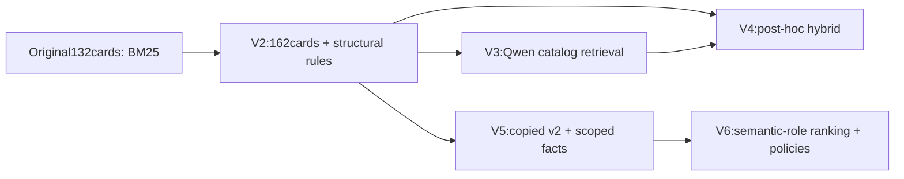

# Python concept retriever versions

| Version | Concept representation / selection | Family+site hit@3 /113 | Native utility /40 |
| --- | --- | ---: | --- |
| V2, public default | Curated conditional mechanisms; AST+BM25 | 74 | 18bug tasks,2false-alarm tasks |
| V3 | Same cards; Qwen-generated concrete where/how/what | 67 | 15bug tasks,4false-alarm tasks |
| V4, opt-in | Duplicate recovery + Qwen/v2 interleaving | 78,post-hoc | Unmeasured |
| V5, opt-in | Same cards + scoped source facts, local provenance, requires/excludes, concept/site pairs | 74,no gain | Unmeasured |
| V6 balanced, opt-in | Semantic applicability/role ranking + one weak fallback | 90, development-adapted | Unmeasured |
| V6 precise, opt-in | Supported candidates only, otherwise abstain | 63, development-adapted | Unmeasured |

Plain Qwen utility baseline:4bug tasks,0false-alarm tasks. Utility input validity,
reference-correct oracles and PUT/reference mismatch are checked separately.
Retrieval metrics use incomplete single-author labels, not an independent holdout.
V5's fact representation and118passing tests do not establish semantic bug truth.

- [Old baseline quality report](retrieval_v3/RESULTS.md).
- [V5 engineering/results](retrieval_v5/RESULTS.md).
- [Representation research and earlier negative experiments](research/representation_20261027/REPORT.md).

Parent baseline committed as163b58a before the actual v2→v5 copy. COPY_MANIFEST
preserves44parent file hashes. No original paper method is reproduced by v5.

V6 retains six development iterations and source snapshots. Balanced returns126
cards vs275; frozen-label matches74.6%vs34.9%, not independent precision.
Precise reduces correct-program over-retrieval100→5/113queries, while trading
coverage.242tests/21native mechanism examples; no new model calls or utility.
See [V6 audit/results](retrieval_v6/RESULTS.md).
