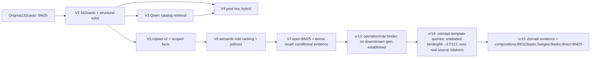

# Python concept retriever versions

| Version | Concept representation / selection | Family+site hit@3 /113 | Native utility /40 |
| --- | --- | ---: | --- |
| V2, public default | Curated conditional mechanisms; AST+BM25 | 74 | 18bug tasks,2false-alarm tasks |
| V3 | Same cards; Qwen-generated concrete where/how/what | 67 | 15bug tasks,4false-alarm tasks |
| V4, opt-in | Duplicate recovery + Qwen/v2 interleaving | 78,post-hoc | Unmeasured |
| V5, opt-in | Same cards + scoped source facts, local provenance, requires/excludes, concept/site pairs | 74,no gain | Unmeasured |
| V6 balanced, opt-in | Semantic applicability/role ranking + one weak fallback | 90, development-adapted | Unmeasured |
| V6 precise, opt-in | Supported candidates only, otherwise abstain | 63, development-adapted | Unmeasured |
| V7 separate CLI | Independent BM25/dense channels;8card evidence overlay; lexical binding | Unmeasured;4engineering sources only | Unmeasured |

Plain Qwen utility baseline:4bug tasks,0false-alarm tasks. Utility input validity,
reference-correct oracles and PUT/reference mismatch are checked separately.
Retrieval metrics use incomplete single-author labels, not an independent holdout.
V5's fact representation and118passing tests do not establish semantic bug truth.

- [Old baseline quality report](retrieval_v3/RESULTS.md).
- [V5 engineering/results](retrieval_v5/RESULTS.md).
- [Representation research and earlier negative experiments](research/representation_20261027/REPORT.md).

Parent baseline committed as163b58a before the actual v2→v5 copy. COPY_MANIFEST
preserves44parent file hashes. No original paper method is reproduced by v5.

V6 retains six development iterations and source snapshots. Balanced returns126
cards vs275; frozen-label matches74.6%vs34.9%, not independent precision.
Precise reduces correct-program over-retrieval100→5/113queries, while trading
coverage.242tests/21native mechanism examples; no new model calls or utility.
See [V6 audit/results](retrieval_v6/RESULTS.md).

V7 [engineering and delivery audit](retrieval_v7/RESULTS.md):23new tests, real Jina
code embeddings CPU,16fixture packets/522new embeddings. This is not semantic
efficacy. Existing V85 integrates V2 into V11; frozen snapshot audit shows206/275
cards use line gates,204of those hit in round1 and only2targeted in round2.
No owner scoring/resume by this work; gate alignment and retrieval need separate
controls. Public `auto` stays V2; V7 is its own module CLI.

2026-10-29 `vr10` [frozen retrieval diagnostic](research/vr10_retrieval_diagnostic_20261029/REPORT.md):
12buggy/12canonical/4oldfixturequeries, unchangedV6+V7A-D. Eight labelled tasks
allhit in everyarm;117blinded sourcebindings reviewed. B-A andD-C each0new supported
buggybindings: NO_GO for current dense package, no integration/promotion/model
retuning.48newlocalembeddings/1092cachehits; noQwen/targetexecution in this diagnostic.

### Local historical notes preserved during main sync

2026-10-30 [vr15 domain/flow improvement](retrieval_v15/RESULTS.md) adds16instances
and5sourceedges overvr14, with0oldinstance losses;69/113tasks,147instances.
33engineeringtests and independent source review of all16newinstances/5edges pass
conditionally. Directlookup=structuredBM25 at147bindings; no retrievalincrement,
testgeneration/efficacy claim or default change. [Current tree](retrieval_v15/VERSION_TREE.md).

2026-10-30 [vr14 concept-template prototype](retrieval_v14/RESULTS.md) moves neutral
concept instances, typed roles and relations before query construction.20engineering
tests pass; authored fixture exact binding raw10/16 vs structured16/16. Unlabeled
source census bindings56→67/113tasks (98→131instances), but no relation edges were
extracted and86/131instances are cardinality. Structured arms identical; no testgen,
canonical use, model calls or default promotion. [Current tree](retrieval_v14/VERSION_TREE.md).
