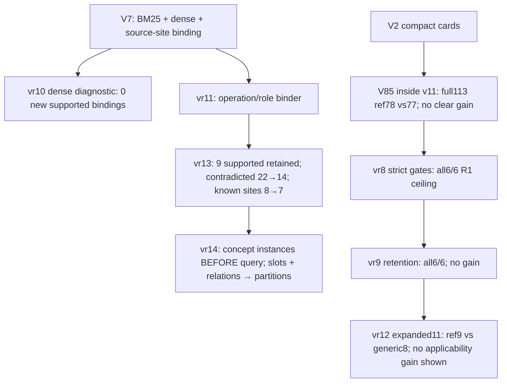

# Retrieval development tree — 2026-10-30

Vr14 reuses vr13's parser metadata and lexical backend. Its new query is built
from neutral semantic instances, not raw AST expression text. Typed roles bind a
retrieved template to source evidence and planned input partitions. This is a
representation prototype, not a downstream v11 test-generation integration.

ConceptCoder informs the distinction between reusable concepts and concrete
measurements/instances. No trained bottleneck or paper implementation is reproduced.
See [RESULTS.md](RESULTS.md) for authored-fixture checks and separate unlabeled census.
Neither metric is a bug-detection score. Old frozen experiments remain unchanged.
