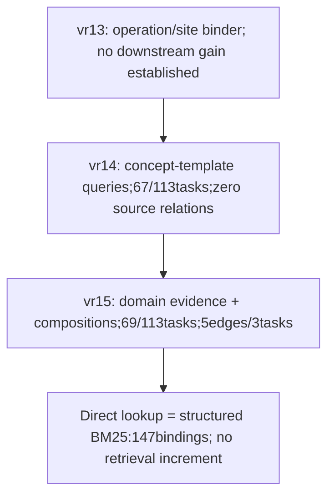

# Retrieval representation tree — 2026-10-30

Vr15 adds source receipts for conditional domains and two operation compositions.
It preserves all old extracted instances; it does not integrate into the v11 loop.
Coverage means a source binding was returned, not a defect or oracle was validated.
Five source edges include repeated/composite descriptions and are not five tasks.
ConceptCoder informs terminology; no paper training/reimplementation is performed.
See [results and limits](RESULTS.md) and [prior tree](../retrieval_v14/VERSION_TREE.md).
