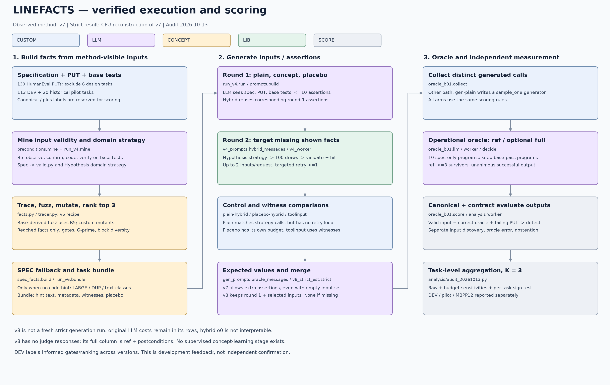
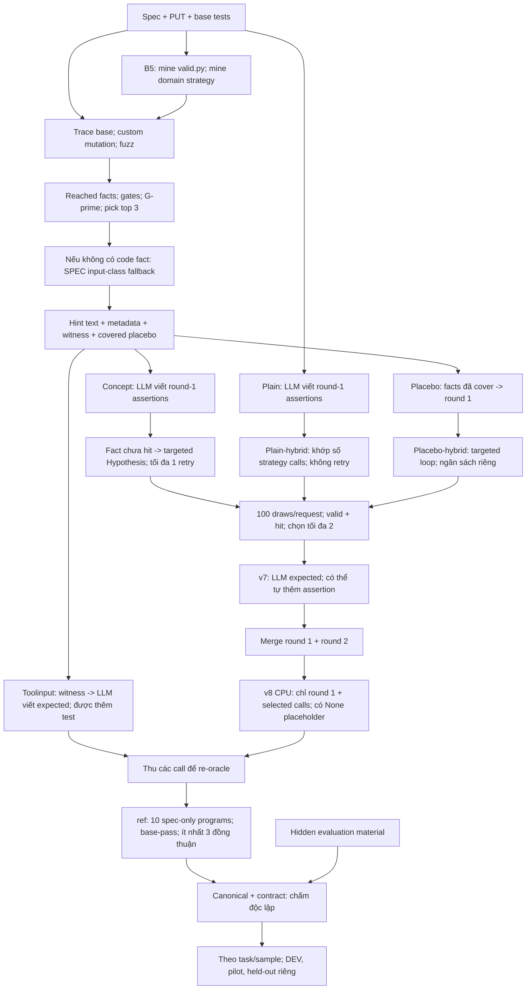
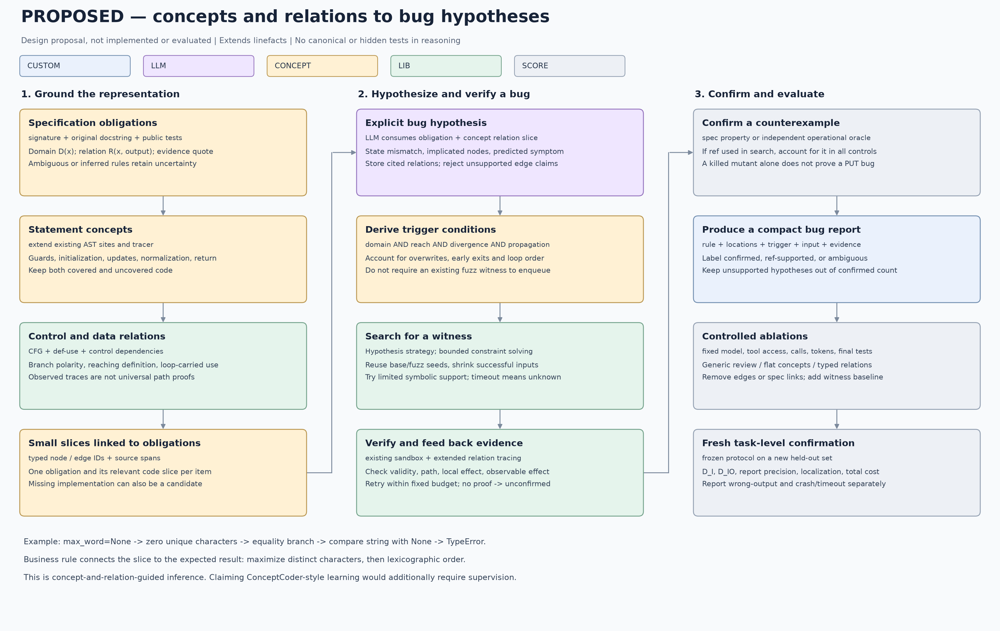
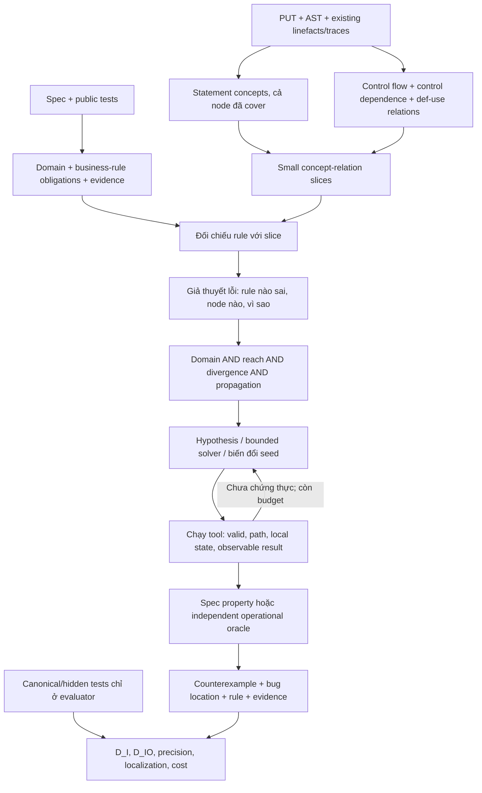

# Kiểm chứng linefacts và hướng concept + quan hệ + giả thuyết lỗi

Ngày kiểm chứng: 2026-10-13. Phạm vi: source hiện có, paper gốc, artifact v7/v8-strict/v9 và MBPP12. Đây là audit và thiết kế nghiên cứu; chưa triển khai phương pháp mới, chưa chạy LLM mới, chưa chạy lại toàn bộ PUT. Không sửa source thí nghiệm hay vendor.

**Kết luận:** linefacts có biểu diễn concept dùng được, nhưng hiện chủ yếu là tool-guided test generation: gap → hint/witness → input → oracle. Chưa có concept learning như ConceptCoder, và chưa chứng minh được lợi ích ổn định của việc LLM suy luận qua concept. Hướng người dùng đề xuất — concept tại node + quan hệ control/data flow + nghĩa của spec → giả thuyết lỗi → trigger → counterexample — là bước phát triển hợp lý hơn. Muốn chứng minh hướng này, phải đo tác dụng riêng của quan hệ và spec, so với một baseline review code có cùng ngân sách.

## 1. Đã kiểm chứng những gì

- Đọc source extraction/ranking, miner, runner, prompts, tracer, evaluator, oracle, dataset adapter và các nhánh mới.
- Tính lại từ **8.211 dòng evaluation**: v7 2.793, v8 2.793, v9 2.373, MBPP12 252. Mỗi run đủ tích task × arm × sample, không trùng khóa, các call được dùng có record execution tương ứng.
- Recompute detection bằng `ref`, false alarm, paired sign test, prefix matching; bổ sung sensitivity lấy tập con ngẫu nhiên cùng kích thước và bootstrap theo task. Chỉ đọc kết quả execution đã lưu, không xem đây là fresh execution replication.
- Script: [analysis/audit_20261013.py](analysis/audit_20261013.py). Số liệu/hash: [analysis/audit_20261013.json](analysis/audit_20261013.json).
- Đối chiếu paper [ConceptCoder §2](https://arxiv.org/html/2603.23470v1#S2), [repo TrickCatcher](https://github.com/RinCloud/TrickCatcher). Không dùng mô tả trong README thay cho kiểm tra source.

Trạng thái cần phân biệt: v7 có run đầy đủ; v8-strict là tái dựng CPU từ v7; v9 đã chạy nhưng kết quả kém hơn v8; v10 chỉ có phân tích offline, không đạt gate để chạy generation; v7_mutref có xác nhận ranking offline, chưa thấy kết quả LLM trong artifact được kiểm. README gốc và một số README nhánh phản ánh mốc cũ, không đại diện toàn bộ trạng thái hiện tại.

## 2. Sơ đồ luồng thực thi hiện tại



[Bản SVG](diagrams/audit_execution_20261013.svg). Source render: [render_audit_20261013.py](diagrams/render_audit_20261013.py).



Sơ đồ Mermaid tập trung các arm quan trọng; `gen-plain` đi qua `sample_one` generator → phân loại input → LLM expected → cùng scorer. B1, postconditions và mutant judge là các oracle phụ trong `oracle_b01.py`.

Các điểm source xác nhận:

- [facts.py:609](facts.py#L609): `pick()` chỉ chọn fact đã `reached`, dùng category/tier/block; không xếp hạng theo một giả thuyết vi phạm business rule.
- [run_v4.py:118](run_v4.py#L118): concept-hybrid tái dùng concept round 1; plain-hybrid tái dùng plain. Control khớp số **strategy requests** thực tế, nhưng nhận request độc lập thay vì vòng retry có feedback như concept.
- [spec_facts.py](spec_facts.py): SPEC là bốn input classes và validator B5. Câu “specification allows it” là suy luận qua validator, không phải chứng minh từ spec. Đây chưa phải khai thác quan hệ input–output của business rule.
- [v8_strict_est.py:18](v8_strict_est.py#L18): giữ round 1 + selected inputs; dùng `== None` nếu thiếu expected. Manifest và nhiều field chi phí/input-summary được chép từ v7. Không lấy các field đó làm chi phí hay summary của một strict run mới.
- v8 không có judge responses; `full` thực tế là **ref + postconditions**. Không đồng nhất nó với full có judge ở các run khác; các số B1 bằng 0 là không có B1 output, không phải model đạt detection 0.

## 3. So với concept của ConceptCoder

Theo [ConceptCoder §2.1–2.5](https://arxiv.org/html/2603.23470v1#S2), concept là ngữ nghĩa trung gian của statement, có nhãn do công cụ tính. Paper học concept cùng downstream task bằng supervision; có cả sequential lẫn parallel integration. Vì vậy không nên quy paper chỉ thành một bottleneck cứng.

| Tiêu chí | linefacts hiện tại | Đánh giá |
|---|---|---|
| Ý nghĩa con người hiểu được | OUTCOME, BOUND, NUM, DU, MUTANT, SPEC | Có nền tảng concept hợp lý |
| Grounding bằng công cụ | Trace, mutant comparison, witness, validator | Có, nhưng hữu hạn và phụ thuộc validator |
| Thông tin trung gian | “Base chưa thử outcome/class/pair X” | Là thuộc tính của **program + tests + execution**, không chỉ code |
| Học nhận diện concept | Không có target concept, loss/head, training stage trong pipeline này | Không phải concept learning của paper |
| Dùng concept để suy luận lỗi | Prompt nhận tối đa 3 hint rồi sinh test | Không có hypothesis trung gian bắt buộc, chưa đo reasoning qua relation |
| Chứng cứ causal | Plain/placebo/toolinput/hybrid controls | Có đối chứng ban đầu, còn confound ngân sách, selection và tool feedback |

Không cần phủ nhận NUM/OUTCOME/DU là concept chỉ vì chúng gần coverage. Vấn đề chính là **cách tích hợp và bằng chứng**, không phải đổi tên vocabulary. Tên claim phù hợp hiện tại: “tool-grounded concept-guided test generation”. Tên “ConceptCoder-style concept learning” chưa phù hợp.

`toolinput` cũng dùng concept: chính facts đã chọn quyết định witness nào được đưa. Do đó toolinput thắng không bác bỏ utility của facts; nó làm yếu claim **LLM đọc hint rồi suy luận ra input tốt hơn công cụ đã tìm được**. Hơn nữa toolinput hiện được thêm test, nên chưa phải pure witness-only oracle baseline.

## 4. Dataset và split có công bằng không?

**HumanEval/TrickCatcher.** Có 139 task, dùng `put0.py` mỗi task, bỏ 6 design → 133; 113 DEV + 20 pilot. Đây là benchmark các chương trình qua base nhưng thất bại trên extended tests. Chọn bug bằng hidden tests để xây benchmark là hợp lệ nếu mọi method chỉ thấy spec/PUT/base. Nó đo khả năng bắt **bug còn sót sau base**, không đại diện mọi hàm ngoài thực tế. Code sử dụng commit TrickCatcher `a0d285a`; phạm vi audit chưa tái kiểm mọi PUT với toàn bộ hidden tests.

**Pilot có selection bias.** Artifact `pilot_tasks.json` cho biết 20 task được lấy từ **82 task có fact** lúc chọn, không từ toàn bộ 133. Giữ nguyên ID qua phiên bản là tốt nhưng không làm pilot trở thành mẫu đại diện. Task không còn fact về sau vẫn phải nằm trong mẫu số; runner hiện giữ chúng.

**DEV/even–odd.** Gates, categories, ranking và nhiều lựa chọn đã dùng kết quả trên DEV. Hai fold từng được dùng cùng để quyết định giữ category, nên không phải train/test độc lập. v7_mutref fit trên 58 even và đo 54 odd có ý nghĩa so trong giai đoạn đó, nhưng odd đã từng được quan sát ở nghiên cứu trước; không gọi đây là held-out hoàn toàn mới. PF dùng 112 DEV có failure, trong khi detection có 113; phải ghi rõ mẫu số.

**Pilot hiện nay là validation lịch sử.** Nó có nhiều kết quả v3/v7/v8 đã xem. Những nhánh mới sau thời điểm này không được lấy pilot làm chứng cứ xác nhận chưa đụng tới.

**MBPP+.** PREREG ghi 378 task gốc, các lượt viết PUT blind rồi lọc base-pass/plus-fail; ghép 58 PUT theo ưu tiên pass, manual label giữ 12 real bugs trước khi chạy arms (amendment 4). [Manifest real12](out/heldout_mbpp_real12/he/manifest.json) xác nhận 12/12 build/verify thành công; README heldout còn nói 58 là mô tả cũ. Không có bằng chứng từ audit rằng chọn 12 dựa vào thắng/thua của arm. Nhưng lọc ambiguity có yếu tố đánh giá thủ công; cần lưu rubric và người chấm độc lập. Ba trong 12 record selection có failure đầu tiên là timeout: nên báo functional-only và including-timeout riêng.

**Kết luận dataset:** chấp nhận được cho exploratory benchmark; chưa đủ cho claim generalization mạnh. Không thấy canonical/hidden tests được đưa vào prompt chính v7 ở các đường đã kiểm, nhưng có feedback từ nhãn DEV vào thiết kế, và nguy cơ benchmark nằm trong pretraining chưa loại trừ. Nếu phát triển hướng relation dựa trên kết quả MBPP12 này, cần một tập xác nhận mới.

## 5. Số liệu tính lại và ý nghĩa

Metric “task/run” là số sample phát hiện chia K=3, **không phải số bug duy nhất**; cũng không phải phần trăm nếu chưa chia số task. Ref là operational oracle từ model, không phải canonical.

| Run, tập | Concept-hybrid | Plain-hybrid | Toolinput | Concept-hybrid vs plain-hybrid: task thắng/thua; sign p |
|---|---:|---:|---:|---|
| v7, DEV 113 | 67.00 | 57.33 | 64.67 | 33/16; .0213 |
| v8-strict, DEV 113 | 61.00 | 55.67 | 64.67 | 29/20; .2529 |
| v9, DEV 113 | 51.33 | 45.00 | 64.00 | 26/19; .3713 |
| v8-strict, pilot 20 | 10.00 | 9.67 | 11.00 | 3/2; 1.0 |
| Frozen v7, MBPP12 | 2.33 | 2.67 | 2.67 | 1/1; 1.0 |

Ở v8 DEV: concept một vòng 48.0 vs plain 45.0, 23/20, p=.761. Concept-hybrid vs toolinput 22/23, p=1.0. So với placebo-hybrid: 61.0 vs 45.33, 33/13, p=.00453, **nhưng ngân sách placebo không khớp**.

Chênh lệch v8 concept-hybrid–plain-hybrid là +5.33 task/run, tương đương +4.72 điểm phần trăm detection/task. Bootstrap ghép cặp theo task: khoảng mô tả 95% **[-2.95; +12.39] điểm phần trăm**. Khoảng này chưa hiệu chỉnh selection và multiple comparisons; không phải suy luận xác nhận trên held-out.

**Sensitivity mới về số test, v8 DEV:**

| Cách cân số call/task/sample | Concept-hybrid vs plain-hybrid | Concept-hybrid vs toolinput |
|---|---|---|
| Cắt prefix tới `min(nA,nB)` như script cũ | 58.33 / 48.00; 34/17, p=.0241 | 46.00 / 62.00; 16/36, p=.00779 |
| Kỳ vọng khi chọn ngẫu nhiên cùng kích thước | 59.40 / 51.58 | 54.14 / 62.50 |

Hàng ngẫu nhiên tính chính xác `1 - C(n-h,m)/C(n,m)` trên các call đã chấm, không chạy thêm model và không gán sign-p cho các kỳ vọng phân số. Prefix phụ thuộc thứ tự (round 1 thường đứng trước round 2); `min(nA,nB)` lại phụ thuộc output method. Hai cách là **sensitivity hậu kiểm**, không thay thế fixed-budget experiment. Kết quả cùng ủng hộ: concept có tín hiệu hơn plain control, chưa vượt witness baseline.

## 6. Những vấn đề fairness quan trọng

| Vấn đề | Bằng chứng thực tế | Giới hạn claim / việc cần làm |
|---|---|---|
| V7 thêm test ngoài input được tool chọn | `run_v4.py` gọi toolinput prompt nếu có strategy request, dù selected rỗng; prompt cho “add others” | v8 giảm confound; main comparison nên chạy strict mới với expected-only prompt |
| Plain khớp số request nhưng khác feedback | 0 budget mismatch ở mọi task/sample v7/v8; concept retry có lỗi, plain dùng request mới | So này đo bundle targeting + filtering + feedback, chưa cô lập hint |
| Placebo được ít compute hơn | DEV v7: concept-hybrid **3.58** calls/sample, placebo-hybrid **1.27**; chưa gồm mining/ref chung | Không dùng thắng placebo làm bằng chứng causal riêng về nghĩa concept; cần matched placebo schedule |
| Không đồng ngân sách tổng | Một vòng vs hybrid, thêm miner/domain strategy, fuzz/mutants, 10 refs | Báo LLM calls, tokens, CPU, wall time và số input/test; shared cost phải được phân bổ minh bạch |
| V8 là dựng lại, không rerun | `strict()` bổ sung placeholder; copy manifest và cost | Ref so input hữu ích; hybrid o0 không diễn giải; full thiếu judge; không tuyên bố cost saving đo được |
| Oracle/scorer chưa đồng nhất hoàn toàn | `oracle_b01.worker.same` dùng `==`; analysis worker có float tolerance | Saved VibePass table ghi **25 call-level mismatch** giữa legacy detection và D_IO-ref ở v8; chưa quy hết nguyên nhân cho float vì còn execution drift |
| Contract không phải semantic ground truth hoàn hảo | V8 analysis có 51 call occurrences hợp contract nhưng canonical lỗi | Báo invalid/ambiguous/canonical-error riêng; không ép tất cả thành lỗi method hay bug PUT |
| False alarm có mẫu số khác nhau | TC emit khi khác PUT; ref có thể emit cả test pass PUT | Tách FA/all-tests, precision/bug-reports, sample false-positive; chạy correct-PUT controls cho mọi arm |
| Nhiều phiên bản/cặp được thử trên DEV | PREREG/RESULTS có lịch sử v3–v10 và nhiều oracle | P hiện tại nominal; chốt một primary comparison, dùng Holm cho family secondary đã định và fresh held-out |

**Baseline paper cần báo đúng phạm vi.**

- `tc-full` có 10 PUT-guided variants, 4 generators, base filtering, pooling/resampling và voting; templates có kiểm hash. Đây gần baseline đầy đủ hơn `dpp`/`tc` trong oracle report, vốn chỉ đổi oracle trên input do method khác đã sinh.
- Tuy nhiên lỗi adapter tuple **vẫn tồn tại** trong [generator_worker.py:53](generator_worker.py#L53). JSON đổi tuple lồng thành list rồi roundtrip gate loại input. Task 127: cả 4 generators bị loại 100/100 input, pool rỗng, dù 7 variants sống. Đã đối chiếu [task_summary.json](out/tcfull_qwen7b/task_summary.json), không chỉ nhắc lại audit cũ. Lỗi này ảnh hưởng cả nhánh dùng chung generator worker, không phải thiếu sót riêng của paper. Chưa nên claim thắng TrickCatcher một cách dứt khoát trước khi sửa adapter/chạy CPU lại ở output mới.
- TC bỏ call khi PUT không trả output thành công; linefacts tính nhiều crash/timeout là detection. TC timeout 1s, oracle worker 3s, các evaluator khác có budget khác. Cần một scorer chung và hai bảng functional-only / including-crash-timeout. Ba resamples TC chia sẻ pool/variants, khác ba sample generation độc lập.
- `onlydoc`/`advdoc` là **prompt adaptations** từ EvalAndMitigate sang Python/Qwen; final generation không thấy PUT/base như concept. `advdoc` còn có bước review/correct/docstring trước. Phần fix-then-diff không được chạy theo phạm vi đã đăng ký. Không gọi kết quả này là đánh bại toàn bộ phương pháp gốc; nó là external comparison, còn causal control chính vẫn là plain cùng thông tin/công cụ/ngân sách.

## 7. Hướng mới: concept và quan hệ để tìm bug trước, rồi tìm trigger



[Bản SVG](diagrams/proposed_relations_20261013.svg). Đây là đề xuất **chưa triển khai/chưa có kết quả**.



**Đây là thay đổi mục tiêu thật:** hiện tại hỏi “base chưa exercise gì?”; phương pháp đề xuất hỏi “implementation có thể vi phạm nghĩa vụ nào của spec, qua quan hệ nào?”. Coverage vẫn là evidence, không còn là điều kiện để một chỗ đáng nghi được xem xét.

Chỉ có CFG chưa đủ. CFG cho biết bước nào có thể đi tiếp bước nào; cần thêm data dependence/def-use và control dependence để biết giá trị nào chi phối output. Cách kết hợp này có nền tảng ở [program dependence graph của Ferrante và cộng sự](https://bears.ece.ucsb.edu/class/ece253/papers/ferrante87.pdf). Đây là lựa chọn thiết kế cho linefacts, không phải khẳng định paper ConceptCoder đã làm một graph reasoning system.

### 7.1 Đã có gì và thiếu gì?

| Thành phần | Đã có trong linefacts | Phần cần bổ sung |
|---|---|---|
| Node facts | STMT/OUTCOME/BOUND/NUM/SHAPE/LOOP/OUTPUT | Concept ngữ nghĩa như initialization, normalization, accumulator, candidate update, selection, return |
| Relations | DU; REL giữa giá trị; DECISION cặp T/F; G-prime guard forcing | Quan hệ có loại và ID node: control-dependent-on, reaches-definition, loop-carried, overwrites, influences-return; scope theo invocation/iteration |
| Mutation | MUTANT hit đòi output/status khác, đã xét propagation | Gắn mutant với giả thuyết vi phạm rule; khác mutant chưa chứng minh PUT sai |
| Spec | B5 chủ yếu input validity; SPEC input classes; BEHAV offline | Domain + input/output relation + tie-break/order/duplicate/normalization requirements, gắn evidence và mức chắc chắn |
| Selection | Chọn reached gaps, đa dạng kind/block | Chọn obligation/slice đáng nghi; giữ candidate chưa có witness trong queue tìm kiếm |
| Reasoning | LLM viết test/strategy theo từng hint | Output có cấu trúc: hypothesis, node/edge evidence, trigger predicate, expected violation |

DU hiện là bằng chứng động có giới hạn; DECISION có thể ghép hai outcome ở hai vòng lặp khác nhau trong cùng call. Không biến chúng thành “cùng path/cùng iteration” nếu tracer chưa chứng minh. `REL` hiện tại cũng không đồng nghĩa quan hệ giữa node trong CFG.

### 7.2 Một ví dụ thực trên PUT hiện có

[HumanEval_158/put0.py](../vendor/TrickCatcher/Datasets/EvalPlus/PUTs/HumanEval_158/put0.py) có business rule: chọn từ nhiều ký tự phân biệt nhất; nếu hòa chọn thứ tự từ điển nhỏ nhất.

```python
max_word = None
max_unique = 0
for word in words:
    unique = len(set(word))
    if unique > max_unique:
        max_unique = unique
        max_word = word
    elif unique == max_unique:
        if word < max_word:
            max_word = word
return max_word
```

Chuỗi suy luận có thể kiểm bằng tool:

1. Concept tại node khởi tạo: candidate chưa tồn tại (`None`), score = 0.
2. Concept tại node đếm: số ký tự phân biệt của chuỗi rỗng = 0.
3. Quan hệ: trên iteration đầu, `unique > 0` false, `unique == 0` true; định nghĩa `max_word=None` vẫn tới phép so sánh, chưa qua assignment trong nhánh update.
4. Giả thuyết lỗi: nhánh tie-break dùng candidate chưa được khởi tạo bằng một string. Đây là lỗi phối hợp initialization, guard và def-use, không chỉ “chưa cover nhánh elif”.
5. Trigger đủ cho ví dụ: list không rỗng, phần tử đầu `''`; sau đó có các từ hợp lệ. Input đã có trong log: `find_max(['', 'b', 'bb', 'bbb'])`.
6. Spec yêu cầu `'b'`; execution record [v8 oracle/158](out/oracle_v8strict_est/exec/158.json) ghi contract-valid, PUT `TypeError`, canonical `ok`, ref emit đúng và PUT không khớp.

Đây là **phân tích thủ công minh họa dựa trên source và log cũ**, không phải kết quả một hệ thống graph mới tự tìm được bug. Với spec mơ hồ về chuỗi rỗng, một method chỉ thấy spec phải ghi nhận mức chắc chắn và dùng operational oracle; evaluator dùng contract để kiểm chứng sau.

Ví dụ khác: [HumanEval_48](../vendor/TrickCatcher/Datasets/EvalPlus/PUTs/HumanEval_48/put0.py) làm `lower().replace(' ', '')` trước palindrome check. Graph có thể chỉ ra normalization truyền vào quyết định trả về; bug hypothesis phải hỏi spec có cho phép bỏ hoa/thường và khoảng trắng không. Log có `is_palindrome('Aba')` hợp lệ, PUT khác canonical. Không được tự bịa business rule “phải bỏ whitespace” vì ứng dụng khác thường làm vậy.

### 7.3 Dạng dữ liệu nên dùng

Một hypothesis record nên có: `rule_id`, quote/spec source và confidence; `nodes` với source spans; `edges` có loại, provenance static/dynamic và scope; `hypothesis`; `trigger_predicate`; `predicted_observable_violation`; `witness`; `verification_status`.

Phân biệt **observation**, **inferred hypothesis**, **validated counterexample**. Chỉ record cuối được tính là bug report đã xác nhận. Không yêu cầu có witness ngay khi lập hypothesis: điều kiện đó sẽ tái tạo nút thắt `pick(reached=True)` và chỉ đi lại các input mà fuzz đã tìm được.

Đối với function thuần có output, mục tiêu xác nhận là tìm `x` sao cho `D(x)` và `not R(x, PUT(x))`. Nếu spec cho phép nhiều output đúng, `R` phải là quan hệ, không ép bằng một canonical string/list duy nhất. Nếu chưa có R executable, dùng oracle độc lập và gắn nhãn độ tin cậy; spec không đủ thì abstain.

Reach–divergence–propagation là cấu trúc chẩn đoán hữu ích, nhưng không phải lúc nào có state đúng để so sánh cục bộ. Với lỗi thiếu đoạn xử lý, candidate có thể là obligation chưa được thực hiện; với exception, lỗi đã observable ngay. Không biến mọi bug thành bắt buộc có một mutant và một “infected state” đo được. [SAVIOR](https://arxiv.org/abs/1906.07327) là nguồn liên quan cho phân biệt prioritization và bug-trigger verification; hướng này còn cần grounding ở spec của hàm.

### 7.4 Giữ cách tìm input nào?

Ưu tiên strategy/constraints có cấu trúc rồi để công cụ sinh dữ liệu. v9 cho thấy đổi riêng từ Hypothesis strategy sang concrete calls + feedback không cải thiện trên Qwen7B; chưa có bằng chứng thêm graph sẽ tự khắc phục khả năng sinh list dài hay giải ràng buộc hẹp.

Tận dụng trace, mutant_src, valid.py, strategy worker, oracle cache sẵn có. Bắt đầu intra-procedural, mỗi hypothesis một slice nhỏ thay vì đưa cả graph vào prompt. Bounded solver chỉ dùng trên kiểu/toán tử hỗ trợ, replay witness trên PUT thật; solver timeout/unsupported là unknown, không phải unreachable. Không dùng canonical để dẫn search.

## 8. Baseline và ablation cho hướng relation

Đề xuất dưới đây là thiết kế để chốt **trước run mới**, chưa phải prereg đã thực thi.

| Arm | Input suy luận | Nó trả lời câu hỏi nào? |
|---|---|---|
| A: generic review | Spec + code + public tests; yêu cầu hypothesis → strategy → verification | Pipeline nhiều bước và thêm compute tự nó giúp bao nhiêu? |
| B: flat concepts | A + node concepts và obligations, bỏ explicit edges | Concept representation thêm gì? |
| C: concepts + typed relations | Cùng node pool/obligations + control/data relations | Quan hệ đóng góp gì trên cùng evidence? |
| D: C bỏ spec-to-code mapping | Vẫn thấy raw spec như mọi arm; bỏ các link obligation ↔ slice | Explicit business-rule alignment có tác dụng gì? |
| E: C với edge control | Mask/shuffle edges cùng schema/token budget, độ biến đổi ghi rõ | Model có dùng nội dung edge? Là diagnostic, không phải baseline cạnh tranh tự nhiên |
| F: witness baseline | Witness từ pool chung + oracle; có thêm witness perturbation ngang budget | Reasoning tốt hơn việc dùng trực tiếp tool inputs không? |
| G: frozen v8 strict mới | Flat hints + Hypothesis + strict expected-only | Lợi ích so hướng linefacts hiện tại |

Thêm **oracle slice** do người/công cụ cung cấp chỉ làm upper bound để tách lỗi extraction và lỗi reasoning, không tính là method hợp lệ trong bảng chính.

Các ràng buộc chung:

1. Cùng PUT/spec/base, model/version và sample count; cùng candidate node/slice pool khi so B–C. Model vẫn thấy code nên có thể tự suy edges: ablation đo giá trị của explicit representation, không chứng minh model “không có relation reasoning”.
2. Chốt ngân sách global trước run: số planning/generation/repair/oracle calls, max tokens, executions, timeout và số final unique inputs. Kế toán cả graph/spec extraction, mining, refs. Trình bày thêm đường detection theo budget; không chỉ cắt output hậu kiểm.
3. Control có cùng cơ hội feedback/repair và các slot round 2; placebo không dừng sớm chỉ vì facts đã cover. Giữ format bằng nhau khi ablate; bỏ cấu trúc thì thay bằng control có độ dài tương đương, không cho arm khác ít compute.
4. Strict oracle chỉ viết expected cho input đã chọn. Muốn đo pure input discovery, đo D_I bằng gold ở evaluator; mọi arm dùng cùng operational oracle cho D_IO. Nếu `mutref`/ref tham gia chọn hypothesis, tính nó vào method và cấp cùng ref access cho control so causal.
5. Sửa scoring/equality/timeout và adapter tuple trước freeze. Chốt cách tính wrong-output/crash/timeout, invalid input, missing output, unresolved spec. Không bỏ task lỗi harness tùy arm; sửa lỗi hoặc báo cùng cohort/ITT đã định.
6. New held-out theo **task/problem**, không chia theo input/hint/PUT cùng đề. Tuning vocabulary, rule extraction, ranker và prompt chỉ trên DEV. MBPP12 và pilot hiện có dùng như validation đã biết; dataset mới cần kiểm contamination/duplicate ở mức có thể.
7. Primary: C vs B trên D_IO hoặc D_I (chọn một trước run); secondary C vs A/F/G và business-rule ablation. CI theo task, sign/permutation theo task; nhiều PUT cùng problem thì cluster theo problem. Hiệu chỉnh family secondary; không lấy task × K × test làm các mẫu độc lập.

## 9. Đo để chứng minh “tìm bug bằng concept–relation”

Giữ các metric hiện có, bổ sung những metric phù hợp claim:

- **Grounding:** precision của node concept/edge trên một mẫu annotation độc lập; quote support và lỗi suy diễn spec; ghi unsupported/unknown.
- **Hypothesis:** tỷ lệ giả thuyết được chứng thực, false bug reports, location trùng fault region đã adjudicate; không dùng line đầu tiên khác coverage làm ground truth lỗi.
- **Trigger:** valid witness rate, thực hiện đúng path/relation, local condition satisfaction, propagation tới output; số call/tool executions và thời gian tới counterexample đầu tiên.
- **Effectiveness:** D_I (input lộ lỗi với evaluator độc lập), D_IO (input ấy đi cùng oracle đúng), bug-report precision, task detection, per-assertion false alarm và correct-PUT false positives. Báo abstention để một method im lặng không có precision đẹp giả tạo.
- **Unique contribution:** bug ở node/branch đã cover, bug đòi quan hệ nhiều node, missing behavior/tie-break/order/duplicate rules; strata xác định trước, không chọn sau khi thấy arm thắng.

PF/good@3 và delivery vẫn dùng làm diagnostic. PF=P(fail|hit) phụ thuộc phân phối hidden inputs và base failure rate; PF≥.5 không chứng minh fact là nguyên nhân lỗi. `good@3` tăng trong v7_mutref chưa suy ra downstream detection tăng, càng không suy ra model học concept.

Ưu tiên thực hiện: đồng nhất scorer và baseline adapters → chốt strict budget → thêm obligation/node/edge records với provenance → baseline generic-review và flat-concept trước → thử graph relations trên DEV → chỉ khi có lợi vượt witness baseline mới freeze để xác nhận mới. Giữ các version/output cũ để audit lịch sử.
