# trickcatcher_linefacts — Execution flows

Source audit: 2026-10-12. This document describes **the execution pipeline**, rather than a version genealogy. Diagram labels use English technical terms; less common terms are explained in the glossary. No `RESULTS.md`/`results.md` was read and no experiment was run.

Evidence: current Python/shell source, preserved prompt templates, historical v3m/v3m2 source-hash manifests, and input/bundle schemas. Numbers below are **configured workloads or bounds**, not measured outcomes. Existing artifacts can bypass preparation, generation or execution; bounds assume a cold cache and successful orchestration unless stated otherwise.

## Navigation

- [Dataset and artifact shapes](#dataset-and-artifact-shapes)
- [v3m / v3m2: end-to-end execution](#v3m--v3m2-end-to-end-execution)
- [Fact extraction internals](#fact-extraction-internals)
- [Generation arms and model inputs](#generation-arms-and-model-inputs)
- [v4: library-based preparation and hybrid generation](#v4-library-based-preparation-and-hybrid-generation)
- [v3mm / v5: mutation substitution and targeted fallback](#v3mm--v5-mutation-substitution-and-targeted-fallback)
- [v6 / v7: revalidation and specification-class augmentation](#v6--v7-revalidation-and-specification-class-augmentation)
- [Pilot / v3c entry points](#pilot--v3c-entry-points)
- [Evaluation and reporting](#evaluation-and-reporting)
- [Post-hoc oracle / validity experiments](#post-hoc-oracle--validity-experiments)
- [tc-full baseline](#tc-full-baseline)
- [Call counts, batching and concurrency](#call-counts-batching-and-concurrency)
- [Implementation ownership and idea provenance](#implementation-ownership-and-idea-provenance)
- [Glossary](#glossary)
- [Function index](FUNCTION_INDEX.md)

Legend: **CUSTOM** = code implemented in this folder; **STDLIB** = Python standard-library primitive; **LIB** = third-party library; **LLM** = model inference; **CONCEPT** = concept extraction, conditioning or verification; **SCORE** = evaluation-only evidence. A custom algorithm built on `ast` remains CUSTOM: using a parser does not make its instrumentation or mutation logic a library implementation.

## Dataset and artifact shapes

Let **T** be the selected task count, **S** the generation repeats per task/arm (`--k`, default 3), **H_t** the number of shown facts (0–3), **B_t** the number of runtime calls captured from base tests, and **F_t** the accepted fact-confirmation inputs (0–400). `facts.K=3` is the fact-selection limit; it is **not** generation repeat count S.

| Artifact | Shape and meaning | How consumed |
|---|---|---|
| `tasks.txt` | 139 distinct integer task IDs in this workspace | Split/read as IDs; no tensor dataset loader |
| `humaneval.jsonl` | 164 JSON objects; `{task_id:str, prompt:str, canonical_solution:str, test:str, entry_point:str}` | Map `HumanEval/n` to n; method uses entry, base-test source and PUT source. Canonical is not supplied to generation. |
| `humaneval_plus.jsonl` | 164 JSON objects with the same key types; `test` contains extended-check Python source | `offline.worker()` executes checks to obtain per-input failure labels; `evaluate.evaluate()` obtains canonical code. |
| Cached EvalPlus v0.1.10 JSONL | Per-task record; fields used here include `prompt`, `contract`, `canonical_solution`, `base_input`, `plus_input`, `entry_point`, `atol` | `gen_inputs.load_contracts()` retains **only** `{contract_src: prompt+contract, entry}`; `oracle_b01`/`tc_full` evaluators use additional fields. |
| PUT sources | `vendor/TrickCatcher/Datasets/EvalPlus/PUTs/HumanEval_n/put0.py` | One Python program per selected task; loaded as source, then compiled/executed locally |
| Selection | 139 IDs minus 6 design IDs = **133 non-design tasks**; pilot 20, dev 113 | Design IDs `{22,33,111,122,123,139}` excluded by non-design runners; pilot assignment comes from existing `pilot_tasks.json` |
| Task bundle | `{facts_version, pilot, design_excluded, tasks: Task[T]}`; optional `tools`, `note` | One JSON document, not T separate model requests sent together |
| Fact record | `{task, facts: Fact[M_t], top3: int[H_t], placebo3: Fact[P_t], placebo_all, ...}` | `top3` indexes the full fact pool. M_t varies by program. |
| `gen.jsonl` | One row per `(task, arm, sample)` | Default gen2: **T×6×S**, full T=133, S=3 → **2394 rows**; v4: T×7×S → **2793 rows** |
| `eval.jsonl` | Same row identity plus `asserts: ScoredAssertion[A]`, optional `input_metrics` | Reports aggregate these rows; row count is not assertion count or LLM request count |

The 139 IDs are the IDs listed by this experiment; this document does not infer the earlier selection rule from 164 to 139. Pilot `generate.select()` separately requires at least one confirmed fact and excludes task 50/66 in addition to the six design tasks.

```text
Task = {
  task: int, entry: str, put: PythonSource, base: PythonSource,
  split: "dev" | "pilot",
  concept_facts: str[H_t], concept_meta: Fact[H_t],
  placebo_facts: str[P_t], placebo_meta: Fact[P_t],
  tool_inputs: CallSource[W_t], doc_fail: Diagnostic[],
  facts_version: "v3m" | "v3c" | "v4", ...
}
MinedTask = Task + {mined_valid_src: PythonSource, valid_sha256: str}
V4Task = MinedTask + {strategy_src: PythonSource, strategy_sha256: str,
                     strategy_fallback: bool, mining_summary: dict}

InputPair = (args: tuple, kwargs: dict)      # internal runtime representation
Trace = (cells: set[(site_id:int, class:str)], lines:set[int], status:str, value:any)
Fact = {kind:str, line:int, text:str, witness:int|null,
        reached:bool, witness_call:CallSource|null,
        cell?|cells?|all_cells?|lines?|loop_max?, k?, mutant_src?, ...}
Candidate = {input_repr:str, args?:list, occurrences?:int}
ClassifiedCandidate = Candidate + {valid:bool, call:str|null,
                                  concept_hits:bool[H_t], shown_hits:bool[Q]}
```

`mined_valid_src`, trace cells, witness indices and mutant sources are harness metadata. **Most prompts receive fact text, not the full Fact JSON.** The schema tag `facts_version` selects a runner/evaluator; v3m2/v5/v6 bundles can retain `v3m`, and hybrid adapters retain `v4`.

## v3m / v3m2: end-to-end execution

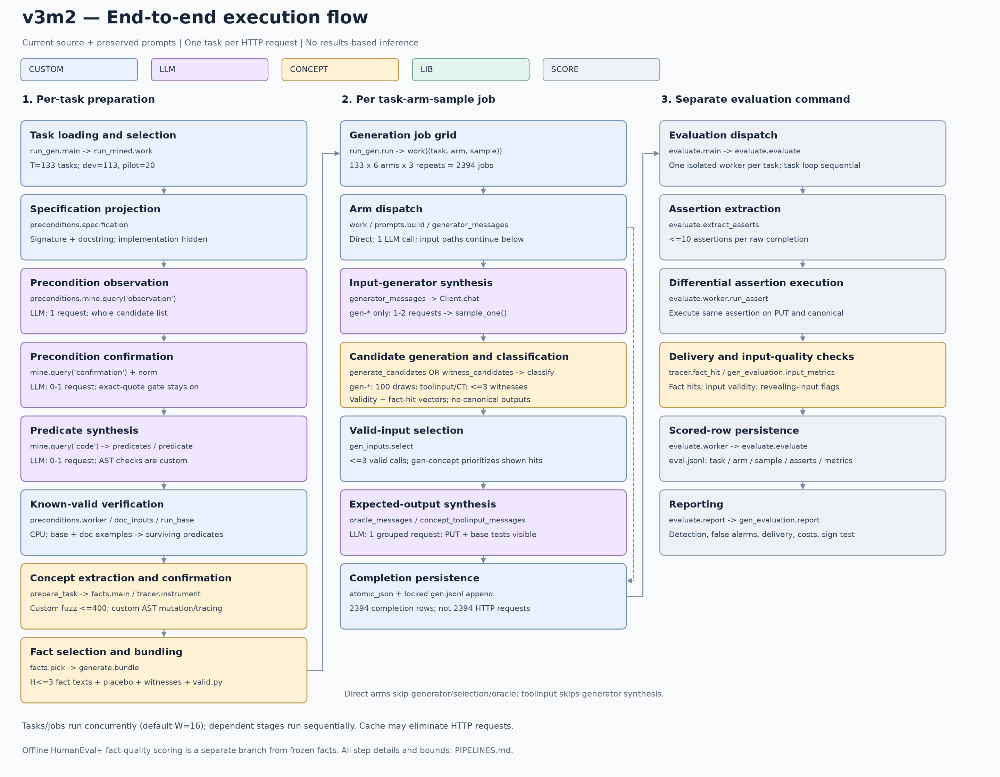

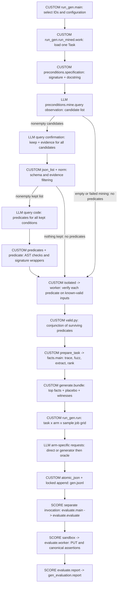

The generation arrow expands into the arm-specific branches below. `run_gen.py` does **not** invoke evaluation automatically: the last two stages are separate commands. Default `main()` uses the mined path; `--from-bundle` bypasses mining/fact preparation.

| Execution order | Function(s), input → output | Ownership / concept / LLM | Scheduling and count |
|---|---|---|---|
| 1. Task selection | `main()` → `run_mined()`; IDs + HumanEval map + existing pilot IDs → Task | CUSTOM + STDLIB `json`, `Path` | `ThreadPoolExecutor(workers=16)` across tasks by default |
| 2. Specification projection | `preconditions.specification(task)` → `(spec_source, docstring, ast.arguments)` | CUSTOM on `ast`; removes implementation body from the mining prompt | Once/task on preparation path; no LLM |
| 3. Observation | `preconditions.mine()` nested `query('observation')` → JSON list `[{id:"P1", condition:"..."}]` | LLM; RBCTest-style prompt attribution | **1 request/task**; all candidate conditions for this task returned together |
| 4. Confirmation | `query('confirmation', candidates)` → `[{id, keep:bool, evidence:str}]`; `json_list()`, `norm()` validate/filter | LLM + CUSTOM evidence gate | **0–1 request/task**; one prompt contains the whole candidate list, not one request/condition |
| 5. Predicate synthesis | `query('code', kept)` → Python defs; `predicates()` → `{id: source}` + dropped diagnostics | LLM + CUSTOM AST allowlist/signature adaptation | **0–1 request/task**; all kept conditions in one request |
| 6. Semantic verification | `isolated()` → `gen_inputs.sandbox()` → `preconditions.worker()`; `doc_inputs()` + `run_base()` provide known-valid examples | CUSTOM; STDLIB `doctest`, `signal`, process APIs | **0 LLM**; predicates and examples traversed sequentially inside one isolated worker. Stop checking a predicate at its first rejected known-valid input. |
| 7. Validator serialization | `mine()` writes `valid.py`, `summary.json`, `verifier.json` | CUSTOM | `valid(*args, **kwargs)` returns AND of survivors; no survivors → `True` |
| 8. Fact preparation | `run_gen.prepare_task()` starts sandboxed `facts.main()` | CUSTOM + CONCEPT; see next section | Once/task, not once/arm/sample; CPU execution has no LLM |
| 9. Task bundling | `generate.bundle()` + `prepare_task()` add texts, metadata, witness calls and validator source | CUSTOM | Top facts shared across all arms/repeats for the task |
| 10. Arm execution | `run_gen.run()` nested `work(job)` where job = `(Task, arm, sample)` | CUSTOM orchestration + LLM | S repeats, 6 default arms; independent jobs parallel, dependent stages within each job sequential |
| 11. Completion persistence | `Client.chat()` records response; `atomic_json()` writes artifact; locked append to `gen.jsonl` | CUSTOM caching/persistence using STDLIB | Row carries model, seed-derived identity, request/token/time metadata, selected inputs if applicable |
| 12. Evaluation | `evaluate.evaluate()` → `evaluate.worker()` → `gen_evaluation.input_metrics()` | SCORE; zero LLM | Tasks sequential in this evaluator; assertions sequential in worker |
| 13. Reporting | `evaluate.report()` → `gen_evaluation.report()` | SCORE; zero LLM | Split/cohort aggregation and paired comparisons; no generation feedback |

**v3m2-specific delta.** Historical manifests for the 133 common tasks show only `precond_prompts.py` changed among the 11 recorded source hashes. Preserved prompts identify the change in **confirmation**: evidence may quote signature or docstring; wording clarifies implications such as non-negative counts; the quote need not itself state the full predicate. Observation/code instructions remain the same. Exact-substring evidence rejection is still enabled. This is different from B5, which sets `evidence_filter=False`. `precond_qwen7b_v2` is the v3m2 validator directory. Current `preconditions.py` is shared code, not a separately preserved old implementation.

Sources: [run_gen.py](run_gen.py), [preconditions.py](preconditions.py), [precond_prompts.py](precond_prompts.py), [historical prompt](out/precond_qwen7b_v2/7/confirmation_prompt.json), [manifest](out/gen2_qwen7b_v3m2/manifest.json).

## Fact extraction internals

`facts.main(n, put_src, he, out, ...)` uses only method-visible source/base tests and the selected validity mechanism. Canonical outputs and HumanEval+ failure labels are not used to construct these facts.

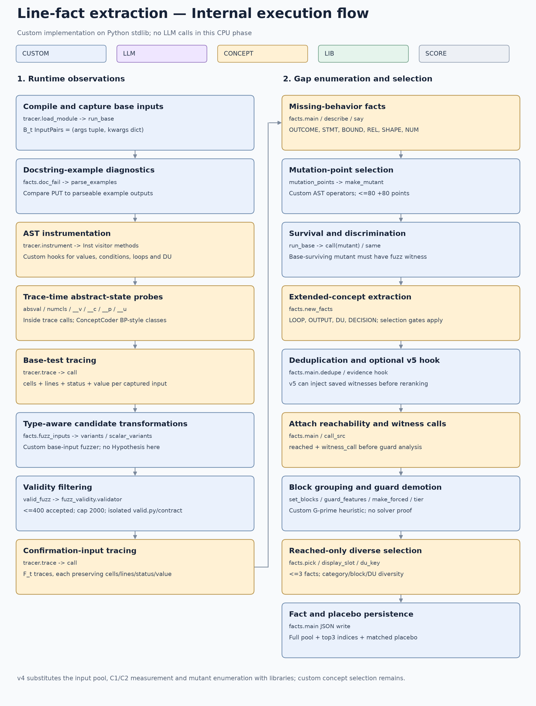

```mermaid
flowchart TD
    load["CUSTOM tracer.load_module + run_base: capture B_t InputPairs"]
    inst["CONCEPT tracer.instrument -> Inst: AST instrumentation and sites"]
    base["CONCEPT tracer.trace: base cells, lines and values"]
    fuzz["CUSTOM facts.fuzz_inputs -> valid_fuzz: up to 400 accepted InputPairs"]
    fzTrace["CONCEPT tracer.trace: confirmation traces"]
    gaps["CONCEPT facts.main + describe: OUTCOME, STMT, BOUND, REL, SHAPE, NUM"]
    mutants["CUSTOM mutation_points -> make_mutant: up to 80 + 80 selected points"]
    survive["CUSTOM run_base: base-surviving mutants"]
    distinguish["CUSTOM call + same: first distinguishing fuzz witness"]
    extras["CONCEPT new_facts: LOOP, OUTPUT, DU, DECISION"]
    evidence["CUSTOM optional evidence hook: v5 witness injection"]
    reach["CONCEPT reached + call_src: attach witness calls"]
    guard["CUSTOM set_blocks + guard_features + tier: G-prime demotion"]
    rank["CONCEPT pick: reached-only round-robin selection, H_t <= 3"]
    persist["CUSTOM fact JSON: top3 + matched placebo + witness calls"]
    load --> inst --> base --> fuzz --> fzTrace --> gaps
    gaps --> mutants --> survive --> distinguish --> extras --> evidence --> reach --> guard --> rank --> persist
```

The ordering is the implementation order: confirmation traces are ready before gap enumeration; mutation testing is performed before the optional v5 evidence hook. The graph is not claiming all categories are always emitted.

| Stage / exact function | What it computes | Implementation and runtime count |
|---|---|---|
| `tracer.load_module()`, `run_base()` | Compile PUT; run HumanEval `check(candidate)` with a wrapper recording deep-copied `(args, kwargs)` | CUSTOM runner, STDLIB compile/exec/copy/sys.settrace; one base-check execution initially captures B_t calls |
| `facts.doc_fail()` → `parse_examples()` | Compare parseable docstring examples to PUT; store diagnostics | CUSTOM parser/check; no LLM. `doc_fail` is not automatically a task exclusion. |
| `tracer.instrument()` → `Inst` visitor methods | Inject hooks at variable/operand reads, conditions/subconditions, entry, loops, definitions/uses and returns | **CUSTOM AST rewrite**, not `coverage.py` in legacy path |
| `tracer.absval()`, `numcls()`, `shape_preds()`, `rel_preds()` | Abstract values and properties: sign/zero/size, empty/nonempty, string classes, relational properties | **CONCEPT enters here**, before prompting; ConceptCoder BP-style abstraction attribution in tracer docstring |
| `__v`, `__c`, `__p`, `__d`, `__u`, `__loop`, `__it` | Runtime probes append `(site_id, class)` cells, def-use and loop counts | CUSTOM hooks on STDLIB; no embeddings or learned concept classifier |
| `tracer.trace()` → `call()` | For each input return `(cells, lines, status, value)` | B_t base traces + F_t fuzz traces, sequential within task. `call()` also has deterministic executed-line budget and wall-clock guard. |
| `facts.fuzz_inputs()` → `scalar_variants()`, `variants()` | Type-aware transformations: signs/boundaries, sequence deletion/reversal/duplication, string case/space changes, cross-parameter relations | **CUSTOM fuzzer**, not Hypothesis/EvoSuite; numerical constants extracted from PUT, up to 12 |
| `facts.valid_fuzz()` | Reject duplicate, nonliteral and validator-invalid candidates | Goal F_t≤400, attempt cap 2000; relational subpool goal 100, cap 500. Checks sequential via validator worker. Goal/cap are not guarantees of accepted input count. |
| `fuzz_validity.validator()` → `Mined` or `EvalPlus` | Isolated persistent validator subprocess; one stdin/stdout transaction per checked candidate | CUSTOM IPC on STDLIB subprocess/select; `Mined` requires `True`, EvalPlus contract acceptance means no exception |
| `facts.main()` gap blocks + `describe()`/`say()` | Missing outcomes/statement runs/invariant flips; fixed English rendering | CUSTOM + CONCEPT; fact text names behavior/line, not expected output |
| `mutation_points()` → `make_mutant()` | ROR/AOR/COR/negation/constant changes plus gated extended operators | **CUSTOM mutator** on `ast`; sample up to 80 legacy points plus 80 extended points; invalid/unloadable points skipped |
| `run_base(mutant)` → `call(mutant,x)` / `call(PUT,x)` → `same()` | Retain base-surviving mutants with at least one distinguishing confirmation input; killed mutants become covered placebo | CUSTOM mutation analysis. At most F_t mutant calls per survivor for witness search; early stop at first difference; unmodified PUT outputs memoized here. |
| `new_facts()` | LOOP/LOOP-MAX/OUTPUT/DU/DECISION facts and placebo | CUSTOM + CONCEPT; may collect facts outside default selection gates |
| `set_blocks()`, `guard_features()` → `make_forced()`, `tier()` | Group nearby guard blocks; force the base-seen guard outcome and inspect witness outputs; demote guard-associated facts with `same`/`necessary` classes | **CUSTOM G-prime heuristic**, not an SMT reachability proof |
| `pick()` → `display_slot()`, `du_key()` | Reached-only selection, two tiers, round-robin categories, block diversity and DU diversity | Default selection slots OUTCOME/STMT/MUTANT/BOUND/NUM/DU; MUTANT-X folds into MUTANT; max 3 |
| `call_src()` + placebo selection in `main()` | Attach first witness call; match placebo kind mix where available | CUSTOM seeded selection; no LLM |

**Execution count is data-dependent.** A task can invoke PUT/mutants much more than 400 times: base capture, instrumented base/fuzz tracing, mutant discrimination, doc examples and guard-forcing comparisons are separate executions. F_t is pool size, not total execution count. No constant total is implied by the source.

Sources: [facts.py](facts.py), [tracer.py](tracer.py), [fuzz_validity.py](fuzz_validity.py).

## Generation arms and model inputs

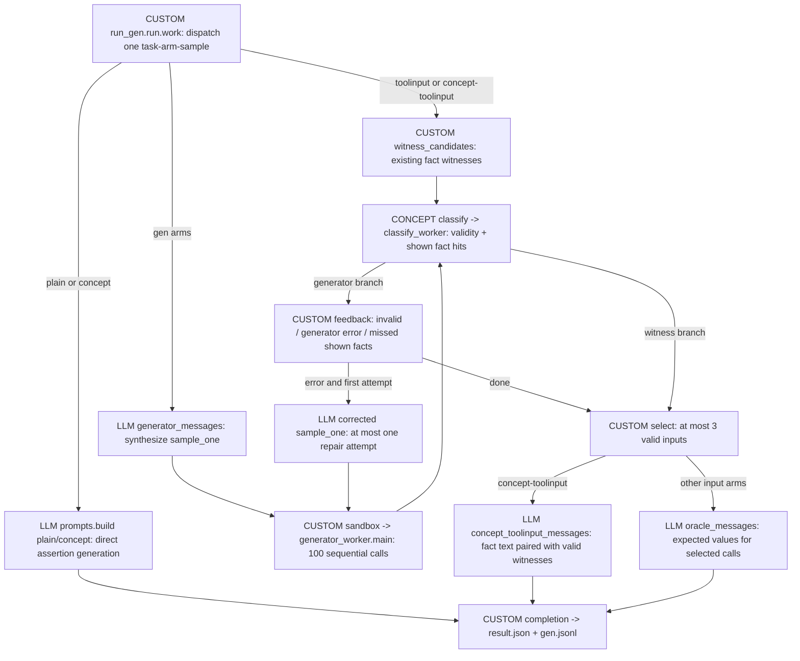

Retry replaces the attempt's candidate pool; it does not union the two pools. Facts shown to the generator enter both the prompt and `shown_hits` checks. Targeted prioritization is in `select()`, not an LLM ranking call.

| Arm / function | Exact model context | Calls per `(task, arm, sample)` |
|---|---|---|
| `plain`: `prompts.build('plain')` | System: expert tester. User: PUT **including docstring** + base tests + instruction for up to 10 assertions | **1** |
| `concept`: `prompts.build('concept')` | Same as plain + all H_t **fact texts together** in `Facts about the existing tests` | **1**; no facts means no extra section |
| Pilot `placebo` / `coverage` | Same white-box context + covered-behavior placebo texts / one generic coverage hint | **1** each; these are not default gen2 arms |
| `toolinput`: `witness_candidates()` → `classify()` → `select('toolinput')` → `oracle_messages()` | PUT + base tests + up to 3 valid witness calls; no concrete outputs and no concept-fact section | **1 oracle call**, including when selected list is empty |
| `gen-plain`: `generator_messages()` | Official TrickCatcher `geninput_generator_sys`/`geninput_usr`: **PUT + docstring**, without the task's base-test section | **1 generator + 1 oracle**, or **2 generator + 1 oracle** after repair |
| `gen-concept` / `gen-placebo` | Official generator context + concept/placebo text list + custom construction instruction for `sample_one()` | Same **2–3**; generator shown-hit checks provide concept feedback |
| `concept-toolinput`: `concept_toolinput_messages()` | White-box direct context + facts paired with their surviving witness calls; `fact_witnesses` preserves alignment | **1**, after CPU witness validation; optional seventh gen2 arm |

`sample_one()` output is a positional argument list/tuple of length equal to function arity. The official prompt recommends `random` and `cyaron`; generated code may use these libraries. The local worker itself does not delegate test generation to cyaron: it invokes the model-written function **100 times sequentially**, deduplicates literal inputs and records duplicate multiplicity. `classify_worker()` then rejects representations over 1000 characters, applies validity, traces PUT and computes fact-hit boolean vectors. `select()` chooses at most three unique valid calls. The LLM produces their oracle in **one grouped prompt**, not three independent requests.

Repair prompt: previous `messages` + `{role:"assistant", content: previous_code}` + `{role:"user", content: feedback}`. The full conversation is resubmitted on retry. Generation is inference, not fine-tuning; there is no training epoch, optimizer or dataset tensor batch in `run_gen.py`.

Sources: [run_gen.py](run_gen.py), [prompts.py](prompts.py), [gen_prompts.py](gen_prompts.py), [gen_inputs.py](gen_inputs.py), [generator_worker.py](generator_worker.py), [official generator template](tc_templates/geninput_generator_sys).

Additional conditioning: if an existing Task contains `requirements: str[]`, `prompts.build()` appends an **Input requirements** section before the assertion instruction (the source calls this F5). This affects direct and o0/paired-witness assertion prompts. `generator_messages()` does not automatically append that field to `sample_one()` synthesis. No independent F5-bundle builder is present in this folder. `onlydoc`/`advdoc` in `gen_evaluation.ARMS` are report-compatible labels, not extra supported `run_gen` generation branches.

## v4: library-based preparation and hybrid generation

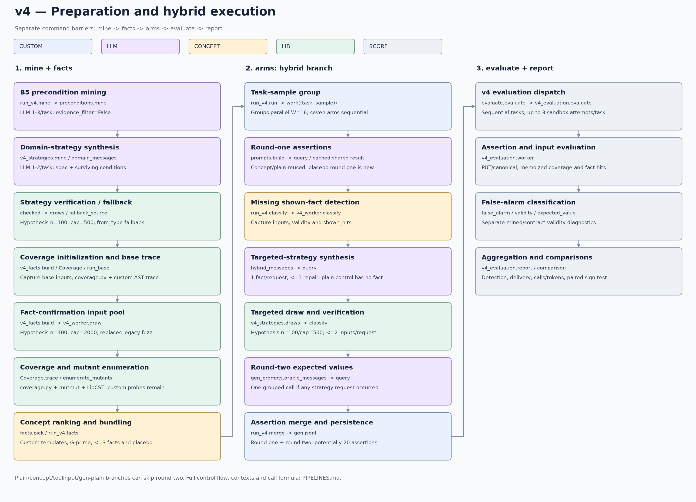

Preparation commands are separate barriers: **`run_v4.main('mine')` → `main('facts')` → `main('arms')` → evaluation → report**. Each command completes its selected tasks before the next is invoked. This differs from inline `run_mined()`, where one task can reach generation while another task is still preparing.

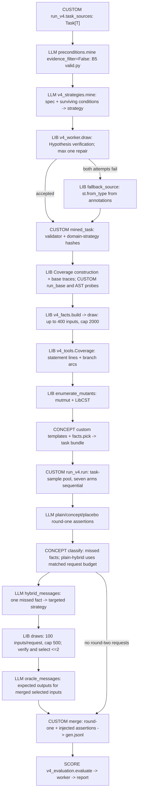

The diagram expands the hybrid branch. `plain`, `concept`, `toolinput` and `gen-plain` have the direct/input flows listed below and can skip round two entirely.

| Stage / function | Library vs local work | Context / scheduling / calls |
|---|---|---|
| `run_v4.mine()` → `preconditions.mine(..., evidence_filter=False)` | CUSTOM RBCTest-style mining/verification | 1–3 LLM calls/task; stages sequential; tasks parallel |
| `v4_strategies.mine()` → `v4_prompts.domain_messages()` | CUSTOM prompt and AST checking; **LIB Hypothesis** provides draws | Spec **without PUT body** + surviving textual conditions; 1–2 LLM calls/task; defaults temperature 0/top_p 1/max_tokens 4096 |
| `checked()` → `draws()` → `v4_worker.draw()` | CUSTOM syntax/arity/literal/validator checks; **LIB** `@given`, `@settings`, `@seed`, `assume`, `Phase.generate` | Strategy verification defaults n=100/cap=500; invalid strategy may trigger one LLM repair |
| `fallback_source()` | CUSTOM annotation projection into **LIB** `st.tuples(st.from_type(...))` | If both synthesis attempts fail; **0 extra LLM calls** |
| `run_v4.facts()` → `mined_task()` → `v4_runtime.isolated('facts')` → `v4_facts.build()` | CUSTOM orchestration; source/version hashes validated | Task pool default 16; within task sequential; reads finished mining artifacts |
| `v4_facts.build()` → `v4_worker.draw(n=400,cap=2000)` | **LIB Hypothesis** replaces the full legacy fuzz pool | Excludes base positional inputs; F_t≤400 unique accepted draws; no new LLM at this stage |
| `v4_tools.Coverage.measure/trace/branch_facts()` | **LIB coverage.py** + custom adapter/fact rendering | C1 statement set and C2 arcs from library; subcondition/value/DU concepts still from custom `tracer` |
| `v4_tools.enumerate_mutants()` | **LIB mutmut** `create_mutations`, operator enumeration; **LIB LibCST** positions/tree replacement; custom point mapping | Up to 80 legacy-family + 80 extended-family selected points; `tracer.run_base`/witness discrimination still CUSTOM |
| `v4_facts.build()` final stages | Reuse CUSTOM `new_facts`, G-prime, templates, `pick`, placebo matching | Concept selection logic remains custom despite tool substitution |
| `run_v4.run()` nested `work((task,sample))` | CUSTOM thread pool | T×S independent groups parallel; **arm order sequential**: plain → concept → toolinput → gen-plain → concept-hybrid → placebo-hybrid → plain-hybrid |
| `concept-hybrid` | Reuses `concept` round-one result; classify shown concepts; synthesize strategy for each missed fact | Up to 3 missed facts × 1–2 calls/fact; same task's requests are sequential |
| `placebo-hybrid` | New placebo-conditioned round-one call; target missed placebo facts | One round-one LLM call, then same strategy/verification process |
| `plain-hybrid` | Reuses `plain` result; no shown fact; generic uncovered-input prompt | Number of requests matches **concept-hybrid's actual strategy requests, including repairs**; one call/request, no strategy repair |
| `v4_prompts.hybrid_messages()` | CUSTOM concept/control prompt | Spec + PUT + base tests + round-one assertions + domain strategy; one target fact for concept/placebo; no target fact for plain-hybrid |
| `v4_strategies.draws()` → `classify()` | **LIB Hypothesis** + CUSTOM validity and fact-hit verification | Each strategy: goal 100 inputs, cap 500; pick ≤2 valid inputs that hit target; malformed draws invalidate that attempt |
| `gen_prompts.oracle_messages()` → `merge()` | LLM then CUSTOM deduplication | Up to 6 selected inputs before dedup, grouped in one oracle prompt; called iff strategy-request count>0, even if final selected list empty |
| `v4_evaluation.evaluate()` → `worker()` → `report()` | SCORE, CUSTOM + coverage.py | Separate evaluator, tasks sequential; up to 3 sandbox attempts/task; **0 LLM** |

`toolinput` in v4 validates and keeps at most 3 witnesses, then calls the same o0 oracle. `gen-plain` still asks for official `sample_one()`, runs it in the same v4 interpreter, validates candidates and calls o0; it is **not** automatically rewritten as a Hypothesis strategy. Round-two merge retains both completions: up to 10 assertions per completion, therefore potentially **20 assertions** in a hybrid row.

Pinned libraries: Hypothesis **6.169.0**, mutmut **3.8.0**, coverage **7.16.2**, LibCST **1.9.0** (`v4_runtime.VERSIONS`). These are code pins, not claims about the latest available versions.

Sources: [run_v4.py](run_v4.py), [v4_strategies.py](v4_strategies.py), [v4_worker.py](v4_worker.py), [v4_facts.py](v4_facts.py), [v4_tools.py](v4_tools.py), [v4_prompts.py](v4_prompts.py), [v4_runtime.py](v4_runtime.py).

## v3mm / v5: mutation substitution and targeted fallback

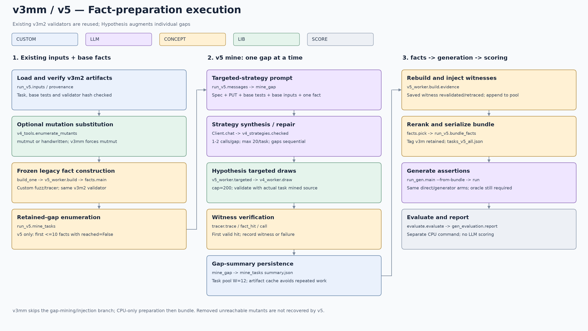

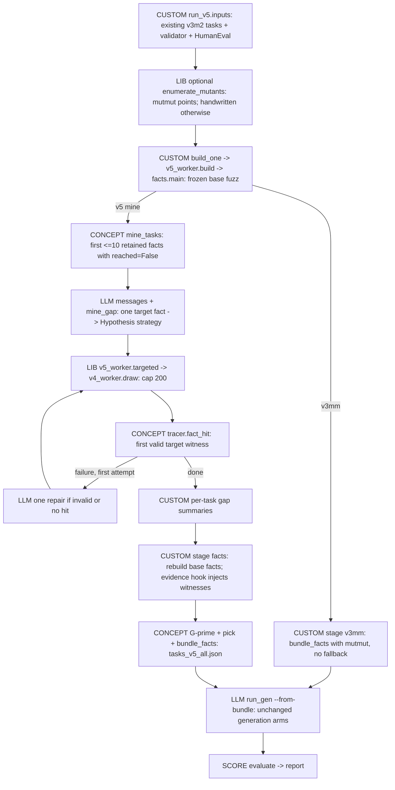

Execution order: existing v3m2 bundle/validators → optional `stage v3mm`, or `stage mine` → `stage facts` → `run_gen --from-bundle` → evaluation → report. `run_v5.py` itself implements **fact preparation only**, not a new generation runner.

- `inputs()` checks task IDs, design exclusions, base-test source and validator hash. The mined validator is **v3m2**, not B5.
- `build_one()` launches `v5_worker.build()`; mutmut points supplied through `facts.main(mutant_points=...)` only when selected. The legacy fuzzer and AST tracer remain.
- `mine_tasks()` takes the first ≤10 `not reached` facts in retained fact order. `messages()` includes **spec + PUT + base-test code + captured base inputs + one fact**, rather than v4's domain strategy.
- `mine_gap()` calls Qwen once, or twice after a repair, with temperature 0/top_p 1/max_tokens 4096. `checked()` validates strategy source; `targeted()` draws up to 200 attempts, mechanically checks validity and verifies actual target hits. Return value is a witness argument-tuple representation, not expected output.
- `mine_tasks()` uses a **12-task thread pool by default**. Gaps and repairs within each task are sequential. LLM count: **0–20/task** for this preparation stage; 200 draws are CPU calls, not 200 LLM calls.
- `stage facts` repeats base construction, loads saved gap summaries, and `v5_worker.build.evidence()` injects each accepted witness **after deduplication but before reached metadata, G-prime and selection**. Input is revalidated/retraced before injection.
- The hook only sees facts still in the pool. Unreachable mutants and some extended facts were already dropped upstream; targeted fallback does not recover everything omitted by fuzz.
- `v3mm` forces mutmut and does not call the LLM during fact preparation. v5 requires an explicit mutant-source choice; it is not necessarily always mutmut.
- `bundle_facts()` preserves the `v3m` schema tag and validator. Generation adds the usual per-arm calls **after** preparation; the new witness does not replace the oracle step.

Sources: [run_v5.py](run_v5.py), [v5_worker.py](v5_worker.py), [v5_offline.py](v5_offline.py).

## v6 / v7: revalidation and specification-class augmentation

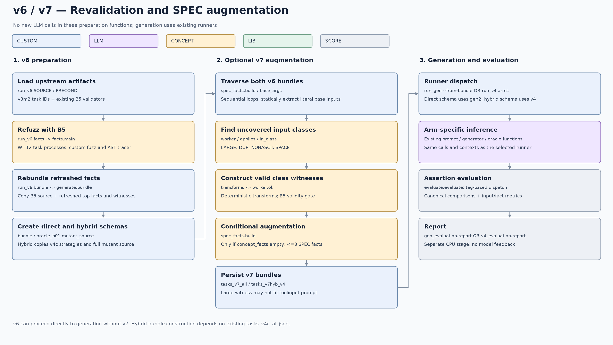

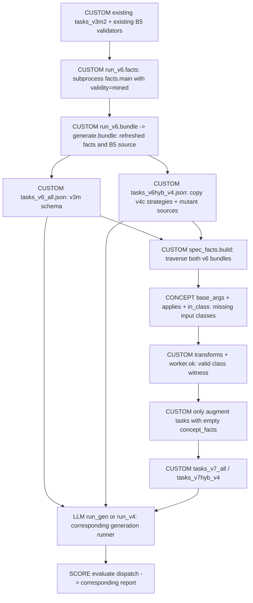

**v6:** `facts(workers=12)` reads selected IDs from v3m2; starts one `facts.py --validity mined --precond-dir out/precond_qwen7b_v4` subprocess/task. Tasks parallel, candidate checking/tracing sequential inside each worker. Existing fact JSON skips work. `bundle()` loops tasks sequentially and writes two bundles; creation of hybrid bundle additionally requires `tasks_v4c_all.json`, whose **strategy metadata** is copied. `oracle_b01.mutant_source()` serializes the legacy mutant AST where full source is needed. **No LLM in these two v6 functions**; B5 mining and domain strategies are upstream artifacts with their own costs.

**v7:** `spec_facts.build()` traverses v6 direct and hybrid bundles **sequentially**; per-task cached worker output can be reused between the two. `base_args()` statically extracts literal positional `candidate(...)` calls from base-test source (it does not dynamically execute loops to capture inputs). `worker()` uses `applies()` and `in_class()` to find uncovered **LARGE/DUP/NONASCII/SPACE** classes; `transforms()` creates fixed candidate values; nested `ok()` applies the B5 validator. It adds at most 3 SPEC facts only when the existing `concept_facts` list is empty, then writes v7 bundles. **No LLM/Hypothesis in SPEC extraction.** Later arm generation is unchanged.

LARGE membership means integer≥1000 or container/string size≥1000; transformations typically try 1500-sized values. Large witness can exist but `witness_call` becomes `None` if its tuple representation exceeds 1000 characters. Direct concept prompts can carry the abstract fact even when `toolinput` cannot carry its concrete witness.

Sources: [run_v6.py](run_v6.py), [spec_facts.py](spec_facts.py), [oracle_b01.py](oracle_b01.py).

## Pilot / v3c entry points

| Path | First-to-last execution | Batching / concurrency |
|---|---|---|
| v3c facts | `run_facts.sh` → sandboxed `facts.main(validity='evalplus')` → `run_gen.bundle_all()` → `run_gen.run()` → `evaluate.evaluate()` → report | Shell `xargs -P 8` default for fact tasks; gen2 requests use 16-worker default; no precondition-mining LLM cost |
| Pilot direct API | Existing historical facts → `generate.select()` or `rebuild()` → `generate.run()` → `prompts.build()` → reused `ULT_concept.generate.Client.chat()` → `evaluate.evaluate()` → pilot report | 20 tasks ×5 arms ×S; each job one prompt; 8-worker default; Gemini model default in this entry point |
| Pilot Kaggle | Existing pilot bundle → `generate.export()` → `kaggle/qwen_gen.main()` → `prepare()` → `generate_vllm()` or `generate_transformers()` → generated JSONL → evaluator | **Explicit inference batch**: vLLM gets a list of prompt-token sequences; Transformers pads tensors and invokes `model.generate()` on batch, recursively splits failed batches |

The pilot's complete exported grid with S=3 is **20×5×3=300 prompt rows**. `kaggle/qwen_gen.prepare()` builds role messages, applies tokenizer chat template, and checks prompt tokens +1024 output budget≤8192 without truncation. `generate_vllm()` passes one `SamplingParams` per row with separate seeds to one engine call. This is actual batching; it is different from gen2's concurrent independent HTTP requests. The Kaggle script's constants pin vLLM 0.7.3 / Transformers 4.48.2.

Source code for earlier v1/v2/v3/v3f fact generators is not independently preserved in this folder. The pilot consumer flow is auditable, but historical producer internals must not be reconstructed merely from folder names.

Sources: [run_facts.sh](run_facts.sh), [generate.py](generate.py), [kaggle/qwen_gen.py](kaggle/qwen_gen.py).

## Evaluation and reporting

Two separate branches follow a **frozen fact bundle**. Neither branch calls the LLM.

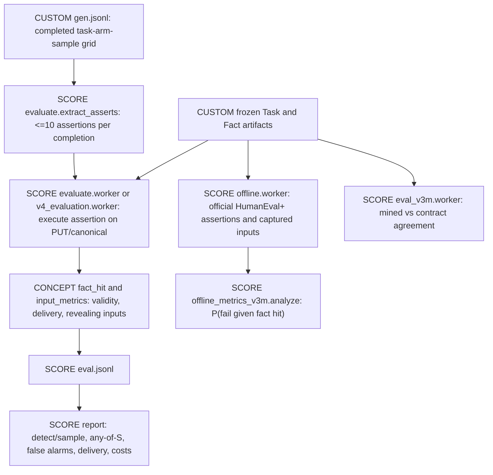

**Generated-test branch:** `evaluate.extract_asserts()` parses AST assertion nodes, with a line-based fallback; it caps each raw completion at 10. `evaluate.evaluate()` groups rows by task and executes one isolated worker/task **sequentially**. Its `facts_version='v4'` dispatch calls `v4_evaluation.evaluate()`, also task-sequential, with up to 3 sandbox attempts/task. Hybrid rows already provide merged assertions; these can contain up to 20.

`evaluate.worker()` compiles PUT/canonical/instrumented PUT and shown mutants once per task. Nested `run_assert()` executes each assertion on canonical and PUT, captures calls, then traces inputs for concept delivery. `gen_evaluation.input_metrics()` separately checks mined validity or EvalPlus contract, unique selected/assertion inputs, canonical-scored status, actual PUT/canonical disagreement and hit vectors. v4's worker additionally memoizes observations and records mined-vs-contract validity / false-alarm classes.

**Exact current reporting rules:**

- Detection in `gen_evaluation.report()` and `v4_evaluation.detects()` is `canon == 'ok' and put != 'ok'` for at least one assertion. These assertion-level counters do **not** independently AND with the separate `input_metrics.valid` flag.
- False-alarm fraction in these reports is number of assertions with `canon != 'ok'` / all assertions.
- `detect/sample` output is sum of detecting rows divided by S, effectively average number of detected tasks per repeat; it is **not** normalized by task count. `any_of_S` counts distinct tasks detected in at least one repeat.
- Delivery is proportion of shown facts reached by at least one emitted assertion; candidate-stage shown-hit rate and final assertion delivery are different measurements.
- `input_metrics.bug_revealing` uses accepted inputs with successful canonical output and PUT exception/output disagreement; it isolates input discovery from whether the LLM wrote the right oracle.
- Paired comparison uses per-task detecting-repeat counts and a custom exact sign test. `doc_fail` cohorts are reported separately.
- `oracle_b01.score()` is a different scorer: there, contract-invalid emitted assertions count as false alarms and do not detect. Do not silently assume all evaluators share one validity policy.

**Offline fact-quality branch:** `offline.plus_check_src()` rewrites the extended check to capture per-input labels; `offline.worker()` executes official assertions, computes per-fact `fail_hits`/`pass_hits` on those inputs and writes one record/task. `offline_metrics_v3m.pf()` computes **PF = fail_hits/(fail_hits+pass_hits)**; `metrics()` uses PF≥0.5 for “strong.” These are fact-quality statistics, not LLM-test detection counts. `eval_v3m.evaluate()` validates frozen hashes, runs `worker()` for validator/contract agreement across selected tasks and invokes `offline.worker()` only for dev tasks. Default task pool is 12. v4/v5 offline wrappers use their corresponding workers/metadata.

**No automatic feedback edge from these scoring stages to generation exists.** Dev gates/ranking are configured in source. If an experiment changes them after an evaluation, that is a new preparation/run, not a hidden stage in this pipeline.

Sources: [evaluate.py](evaluate.py), [gen_evaluation.py](gen_evaluation.py), [v4_evaluation.py](v4_evaluation.py), [offline.py](offline.py), [eval_v3m.py](eval_v3m.py), [offline_metrics_v3m.py](offline_metrics_v3m.py), [v4_offline.py](v4_offline.py), [v5_offline.py](v5_offline.py).

## Post-hoc oracle / validity experiments

These start **after generated tests have been evaluated**, consuming `tasks.json` + `eval.jsonl`. They preserve the input calls and change oracle/filter logic; they are not mandatory stages of every version.

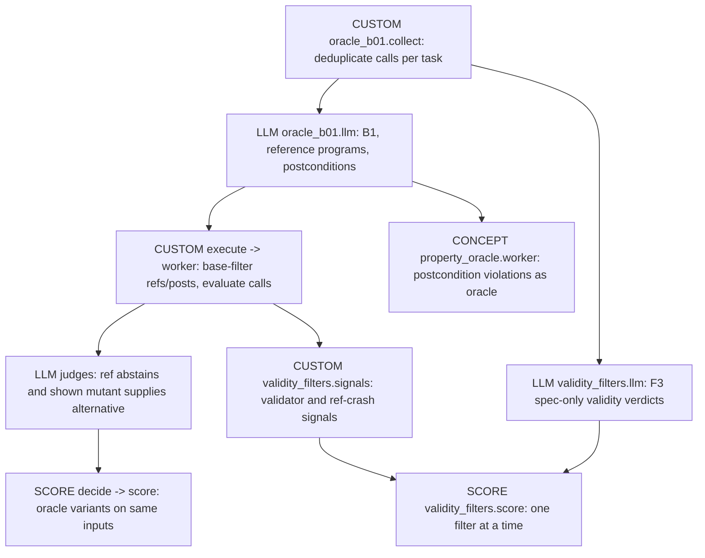

| Branch / functions | Model context and inference count | Non-LLM work |
|---|---|---|
| B1 `chunks()` → `llm()` → `b1_expected()` | Signature/docstring + grouped calls; **3 prompts/chunk/task**; max 10 calls or character accumulation limit 1500 per chunk (a single oversized call can exceed that limit) | Parse expected assertions; emit only unanimous successful expectations; `b1one` uses first sample |
| B2 `dpp_templates()` → `llm(stage='ref')` | Official TrickCatcher DPP template + signature/docstring; **10 requests/task** | Base-filter reference programs; require ≥3 surviving programs and all successful outputs agreeing |
| B3 `llm(stage='post')` → `post_of()` | Spec only; **5 requests/task**, one symbolic assertion/request | Keep postconditions holding on every extracted base `(args,expected)` pair; filter emitted expected values with `+post` |
| B4 `judges()` | Spec + one call + two candidate values from PUT/mutant, randomized A/B order; **1 request/eligible unique call** | Only when B2 abstains and a shown mutant gives a different successful value; `NEITHER` abstains |
| B0 `variants('dpp'/'tc')` | **0 new requests** in this code path | Load previously released GPT-3.5 variant files; does not regenerate their input pool |
| Property oracle `property_oracle.main()` → `worker()` | **0 new requests** after B3 posts exist | Apply kept properties directly to PUT output; canonical/contract used only for scoring |
| F1/F1b/F4/F4b `validity_filters.signals()` → `worker()` | **0 new requests** after validators exist | Apply existing validators; F1=v3m2, F1b=B5 |
| F2 same signal worker | **0 new requests** after refs exist | ≥3 base-surviving refs and ≥half crash/time out → invalid |
| F3 `validity_filters.llm()` → `f3_verdicts()` | Spec + grouped calls; **3 requests/chunk/task** | Majority INVALID drops assertion; missing answer counted without an INVALID vote |
| F4/F4b `precond_concepts.main()` → `preconditions.mine()` | **1–3 requests/task**; observation uses S/B/R/F/D/A categories; F4b adds three rules | Same B5 verification pipeline; no exact-quote filter. This is a **concept-conditioned validator**, different from v4 code-fact extraction. |
| RBCTest ablation `rbc_ablation.one()` | nover: **0**; noconf: **0–1 code request/task**; noconf_nover reuses that code | Drop verifier, confirmation or both; original B5 observation artifacts reused |

`oracle_b01.llm()` submits request jobs to a **16-worker** pool; all 3 B1 samples and chunks can be concurrent. `execute()` runs task workers in a **12-worker** pool; local `worker()` executes reference programs/calls sequentially. `judges()` uses 16 workers. `validity_filters.llm()` function default is 16, but its CLI passes `--workers` default **12**. `property_oracle` and F4/F4b/RBC CLI task pools default 12.

For all default B1/B2/B3 requests: per task count = **3×C_t +10+5**, where C_t is chunk count. B4 and F3 are additional selected branches. “Grouped calls within one prompt” is semantic grouping, not API batch inference.

Sources: [oracle_b01.py](oracle_b01.py), [validity_filters.py](validity_filters.py), [property_oracle.py](property_oracle.py), [precond_concepts.py](precond_concepts.py), [rbc_ablation.py](rbc_ablation.py).

## tc-full baseline

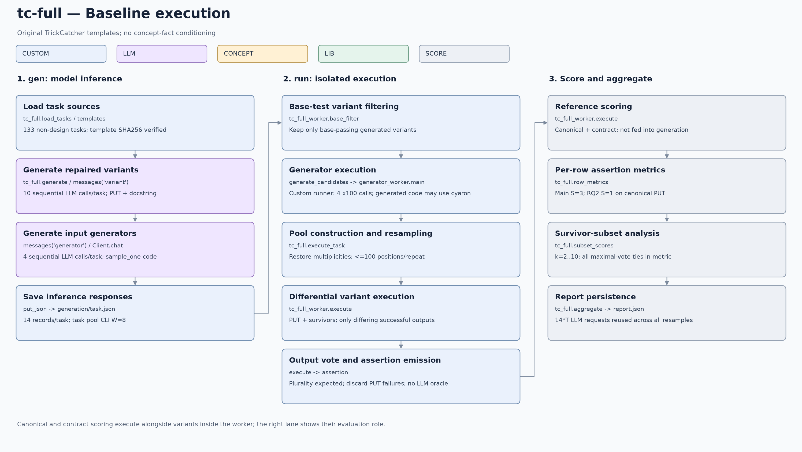

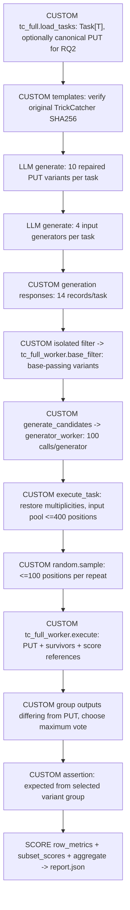

`generate()` uses one task job per worker; within each task it sends **10 variant prompts sequentially, then 4 generator prompts sequentially**. CLI default workers=8. Each call uses temperature=1/top_p=1/max_tokens=2048; model Qwen2.5-Coder-7B-Instruct. Variant prompt sees PUT+docstring and asks for a repaired complete function; generator prompt sees PUT+docstring and asks for `sample_one()`. No concept facts or base tests are added to these prompts.

`run()` is a separate CPU phase. `execute_task()` first keeps variants passing base tests, then runs 4 generators (100 calls each), restores duplicate occurrences into pool positions, and takes up to 100 positions/repeat. Main uses 3 repeats, RQ2 one; the **14 LLM responses are reused**, not regenerated per repeat.

`tc_full_worker.execute()` runs PUT and each surviving variant for an input. Only successful variant outputs differing from a successful PUT output are candidate groups. The emitted expected value is from the group with most variant votes; ties choose the first group for emitted assertions. PUT failures provide no comparison output and are discarded in this implementation. Canonical and contract annotate scoring; **contract does not prefilter the generator pool**. `subset_scores()` separately evaluates k=2..10 survivor subsets and retains all maximal-vote ties for its metric.

T=133 implies **1862 logical LLM requests** for generation (14×133), excluding transport retries/cache; no concept-extraction stage. CPU main emits T×3=399 evaluation rows, not 1862 rows. `aggregate()` produces assertion precision/false alarms/detection and paper-style subset metrics. These are custom aggregation definitions, not the gen2 report formula copied unchanged.

Sources: [tc_full.py](tc_full.py), [tc_full_worker.py](tc_full_worker.py), [tc_templates](tc_templates).

## Call counts, batching and concurrency

### Model request shape

```json
{
  "model": "qwen2.5-coder-7b-instruct",
  "messages": [
    {"role": "system", "content": "stage-specific instruction"},
    {"role": "user", "content": "one task's code/spec/tests/facts or grouped calls"}
  ],
  "seed": 20261010,
  "temperature": 0.7,
  "top_p": 0.95,
  "max_tokens": 1024
}
```

The seed above illustrates the payload field, not every job's actual seed. `Client._chat()` serializes one payload and POSTs `/v1/chat/completions`; it reads `choices[0].message.content`. No `n=S` is submitted: S is an outer job loop with separate deterministic seeds. `gen_prompts.seed()`, `v4_prompts.seed()` and `tc_full.seed()` define different seed schemes. The client uses **STDLIB urllib**, not the OpenAI Python SDK.

| Workload | Calls with cold cache | Clarification |
|---|---|---|
| v3m/v3m2 precondition preparation | **1–3/task** | One request per dependent stage, not per condition |
| Six gen2 arms | **9–12/task/repeat** | 1 plain +1 concept +1 toolinput + three generator arms×(2–3); 399 task-repeats → 3591–4788 calls |
| Optional concept-toolinput | **1/task/repeat** | Additional to the six-arm workload |
| v4 preparation | **2–5/task** | Precondition mining 1–3 + domain-strategy synthesis 1–2; no LLM for drawing/extracting facts |
| v3mm preparation | **0 new calls** | Depends on already prepared v3m2 validators |
| v5 targeted-gap preparation | **0–20/task** | ≤10 gaps×1–2 attempts; generation costs are additional |
| v6/v7 preparation functions | **0 new calls** | Existing B5/domain-strategy artifacts may have upstream LLM cost |
| tc-full generation | **14/task** | 10 variants +4 generators; reused across CPU repeats |
| Generated-test / offline reports | **0** | Separate CPU scoring stages |

**v4 exact generation formula per task/repeat:** let `b` be gen-plain's extra repair (0 or 1), `q_c` concept-hybrid strategy requests (including repairs, 0–6), `q_p` placebo-hybrid strategy requests (0–6), and `I(x)` indicate a positive request count. Actual `Client.chat()` invocations in `run_v4.run()` are:

```text
6 + b + 2*q_c + q_p + 2*I(q_c > 0) + I(q_p > 0)      # range 6..28
```

The six base calls are plain, concept, toolinput oracle, gen-plain generator+oracle, and placebo-hybrid round one. The second q_c belongs to plain-hybrid, whose budget matches concept-hybrid's actual requests. The two I(q_c) are concept-hybrid and plain-hybrid oracle calls. Summing arm-row `llm_calls` adds **two attributed shared round-one calls** (plain/concept reused by their hybrids) beyond those actual invocations. This difference matters for cost accounting.

**Logical vs physical calls:** `Client.chat()` returns cached responses under a SHA256-payload file lock; a warm cache can mean **zero HTTP requests** despite nonzero logical calls in row metadata. Network retries are separate: `retries=8` permits up to **9 transport attempts per uncached logical call**, with early stop for certain non-retryable HTTP errors. Generator/strategy repair is a new model completion; HTTP retry resends the same payload.

### Scheduling matrix

| Entry point | Parallel unit | Within-unit order | Explicit inference batching? |
|---|---|---|---|
| `run_gen.run_mined()` | Outer tasks; inner task-arm-repeat jobs constrained by shared `job_slots`; shared Client request semaphore | Task mine→facts→bundle before its arms; per-arm stages sequential; another task may still prepare | **No** |
| `run_gen.run()` from bundle | `(task, arm, sample)` jobs, default 16 workers | Generator→draw→classify→optional repair→select→oracle | **No** |
| `run_v4.mine/facts()` | Tasks, default 16 workers | Precondition→domain strategy in mine; facts command after mine barrier | **No** |
| `run_v4.run()` | `(task, sample)`, default 16 workers | Seven arms sequential; requests/repairs per hybrid sequential | **No** |
| `run_v5.mine_tasks()` | Tasks, default 12 workers | Build base facts, then gaps sequentially with dependent repairs | **No** |
| `run_v6.facts()` | Tasks, default 12 workers | One facts subprocess per task | None at this stage |
| `run_v6.bundle()` / `spec_facts.build()` | Sequential task loops | v6 bundle loop; v7 first direct bundle then hybrid, cached worker reuse | None at this stage |
| `tc_full.generate/run()` | Tasks, CLI default 8 workers | 14 inference requests sequential per task; CPU generators/repeats sequential per task | **No** |
| `evaluate.evaluate()` / v4 evaluator | Sequential tasks | Assertions sequential in isolated worker; v4 retries sequential | None |
| `eval_v3m.evaluate()` | Tasks, default 12 workers | Quality then dev offline scoring for each task | None |
| `kaggle/qwen_gen.generate_vllm()` | List of all pending prepared jobs handed to engine | Engine scheduling internal to library | **Yes**, token-sequence batch |
| `kaggle/qwen_gen.generate_transformers()` | Padded prompt tensor batch | Custom per-row sampling; sequential recursive splits on failed batches | **Yes**, tensor batch |

The HTTP server may internally batch concurrent requests, but this is **not controlled or guaranteed by `run_gen.py`**. The bounded semaphore constrains concurrent `Client.chat()` entries, not a specified GPU batch size. `Client.chat_many()` also uses a thread pool, not a batch endpoint; main runners call `chat()` through their own pools.

Source: [llm_client.py](llm_client.py), runner functions above, [Kaggle batch implementation](kaggle/qwen_gen.py).

## Implementation ownership and idea provenance

This table separates **an idea borrowed from a paper**, **an original prompt artifact reused**, and **an implementation delegated to a library**. Attribution follows explicit comments/templates in the code; it does not claim a complete faithful reproduction of each paper.

| Pipeline component | Idea / source attribution | What actually runs |
|---|---|---|
| PUTs and generator/program templates | TrickCatcher author artifacts; commit `a0d285a77efff7c93fc280d606497d9de5e1defe` recorded in `gen_prompts`/`tc_full` | Original source files read without editing; templates verified by SHA256 |
| Input-generator prompting | Official TrickCatcher `sample_one()` template | Original prompt + custom concept suffix; local Client, sandbox, validity filtering and selection |
| Abstract runtime values | ConceptCoder **BP-style** classes, explicitly named in `tracer.py` docstring | Local CUSTOM `absval`, `Inst`, hook and trace implementation; no ConceptCoder library invocation |
| Preconditions | RBCTest observation/confirmation **idea**, explicitly stated in `precond_prompts.py` | CUSTOM prompts, exact-evidence gate, AST predicate validator and known-valid verifier; Qwen inference |
| C1/C2/C3, boundaries, equivalence classes, loop, DU, mutation/RIPR vocabulary | Classical test-adequacy concepts named in `facts.py`/templates | CUSTOM probes/templates/ranking; v4 delegates C1/C2 measurement and mutant enumeration to libraries |
| Fuzz confirmation | Local type-aware transformations | CUSTOM `facts.variants`/`valid_fuzz`; not a symbolic solver or imported fuzz engine |
| G-prime, ranking, placebo matching | Local experiment heuristics in `facts.py` | CUSTOM guard-forcing comparisons, diversity and seeded matching |
| v4/v5 strategies | Hypothesis library mechanism, with custom LLM synthesis/feedback | Model writes strategy code; Hypothesis generates draws; CUSTOM validates hit/arity/literals |
| v4 mutation/coverage | mutmut / coverage.py / LibCST APIs | Library enumeration/measurement; CUSTOM adapters, base survival tests, confirmation and concept rendering |
| B2 oracle | TrickCatcher DPP prompt | Original template + CUSTOM reference agreement rule |
| B3 postconditions | **DeCon-style** postcondition filtering attribution in `oracle_b01.py` | CUSTOM synthesis/parser/base-pair filter; not a call into a DeCon package |
| B4 judge, hybrid controls, SPEC classes | Local code paths and prompts | CUSTOM policies and LLM or deterministic transformations as marked above |
| Inference engine | Qwen model; HTTP-compatible serving, or vLLM/Transformers in Kaggle script | Wrapper implemented locally; model execution external/server or third-party engine |
| Evaluation | HumanEval/HumanEval+ checks and canonical references | CUSTOM isolated execution and metric aggregation; no LLM grader in ordinary generated-test scoring |

## Glossary

| Term | Chú thích |
|---|---|
| **PUT — Program Under Test** | Chương trình đang được kiểm thử, ở đây là `put0.py`. |
| **Entry point / arity** | Tên hàm được gọi / số positional arguments hàm nhận. |
| **Specification projection** | Trích signature và docstring, bỏ body implementation trước khi đưa vào miner. |
| **Precondition / predicate** | Điều kiện input phải thỏa / hàm boolean kiểm tra điều kiện đó. |
| **Postcondition / oracle** | Điều kiện output cần thỏa / cơ chế quyết định kết quả đúng của test. |
| **AST instrumentation / probe** | Sửa Abstract Syntax Tree để chèn điểm ghi nhận trạng thái lúc chạy. Đây là thao tác trên bản compile trong worker, không sửa source tác giả. |
| **Abstract value / equivalence class** | Gom giá trị cụ thể thành nhóm, như zero/negative/empty, để mô tả hành vi kiểm thử. |
| **Cell / site** | Cặp `(vị trí instrumentation, nhãn trạng thái)` / vị trí được gắn probe. |
| **Witness / reachability** | Input cụ thể chứng minh một hành vi có thể xảy ra / khả năng input đạt hành vi đó; ở đây là xác nhận thực nghiệm, không phải proof. |
| **Mutant / surviving mutant** | Chương trình bị thay một chi tiết / mutant vẫn pass base tests. |
| **Distinguishing input** | Input khiến PUT và mutant khác output hoặc trạng thái chạy. |
| **RIPR** | Reachability, Infection, Propagation, Revealability: các điều kiện để lỗi được test bộc lộ; code ở đây chủ yếu quan sát survival và output/status differences. |
| **DU / c-use / p-use** | Definition–Use: giá trị từ assignment đến nơi sử dụng; computational use / predicate use. |
| **C1 / C2 / C3** | Statement coverage / branch coverage / condition coverage. |
| **ROR / AOR / COR / UOI / CRP** | Relational/Arithmetic/Conditional Operator Replacement; Unary Operator Insertion vocabulary; Constant Replacement. Tên family trong code, không ngụ ý đủ mọi operator chuẩn. |
| **G-prime demotion** | Heuristic giảm thứ hạng facts gắn với guard khi forcing cho thấy hành vi giống hoặc guard cần thiết để tránh lỗi. |
| **Placebo / ablation** | Điều kiện đối chứng / bỏ một bước để đo đóng góp của bước đó. |
| **Hypothesis strategy / draw** | Đối tượng mô tả cách sinh input / một giá trị được strategy sinh ra. Một draw không phải một LLM call. |
| **Literal round-trip** | `repr` rồi `ast.literal_eval` khôi phục input bằng giá trị gốc, để harness truyền input ổn định. |
| **Batch / concurrency / barrier** | Nhiều prompt xử lý trong một engine batch / nhiều job đồng thời / chờ giai đoạn trước hoàn tất rồi mới chạy giai đoạn sau. |
| **Semantic grouping** | Nhiều conditions/calls trong cùng một prompt của một task; không đồng nghĩa nhiều task trong batch GPU. |
| **Logical call / transport attempt / repair** | Lần xin completion / lần HTTP thực tế / xin completion mới sau feedback. Cache có thể làm logical call không cần HTTP. |
| **Canonical implementation** | Implementation tham chiếu dùng để chấm output/assertions; không đưa vào method-side prompt. |
| **Delivery / PF / any-of-S** | Fact được input/test cuối đạt / xác suất fail khi đạt fact / task được phát hiện trong ít nhất một repeat. |
| **Resample / plurality vote / abstain** | Lấy mẫu lại pool / chọn nhóm có nhiều phiếu nhất (không nhất thiết quá 50%) / không phát expected khi không đủ evidence. |
| **Sandbox / provenance / immutable artifact** | Worker có giới hạn thực thi và namespace mạng tách biệt / thông tin nguồn và hash / artifact không được trộn với cấu hình khác. Sandbox ở đây không phải lời khẳng định cách ly filesystem toàn diện. |

All executable source links and function names can be checked in [FUNCTION_INDEX.md](FUNCTION_INDEX.md). [pipeline_source_manifest.json](diagrams/pipeline_source_manifest.json) records audited source hashes. Diagrams are reproducible with [render_pipelines.py](diagrams/render_pipelines.py), which renders documentation only. Earlier [VERSIONS.md](VERSIONS.md) is retained as a version map; this file is the requested execution-flow specification.

- **v32_scope_support** (2026-10-19, best-v7 copy + v25 ports): lexical comprehension scopes and cumulative witness support;48 CPU pass. Fresh Luna seen5 Atrue/Bfalse/Cblocked on f06 wrong trigger signature;scope fix exercised,support promotion model-untested,no comparison/promotion. See analysis/v32_scope_support_20261019/REPORT.md.

- **v40_concept_agent** (2026-10-21): Astra7relationcatalog + seen8/3arm selective-revision diagnostic; best-v7/v30ports, CPU12/audit/sourcefreeze pass. Endpointmodels404,0Qwentaskcalls/all72notattempted; waitingliveendpoint, noefficacyclaim. See analysis/v40_concept_agent_20261021/REPORT.md.

- **v43_concept_identify** (2026-10-22): COMPLETE18responses/6blocked; rawbinding+judgment1/8/tool2/8,1semanticwin/0loss butgate>=2+valid8 unmet, NO-GO.78reusedrows/0newPUT;60source/deps/parentinventories/auditsPASS. Readiness1fail preserved+prospectiveengineeringamendment. See analysis/v43_concept_identify_20261021/REPORT.md.

- **v78_learned_select** (2026-10-26): saved v47 menu → group-held-out supervised selection;33 PUTs/24 specification groups. Context18 vs random18.25, context-removed19, subtype prior20.5; secondary21=context-free. Registered NO-GO,11 synthetic tests,1743 cache fingerprints verified,0 API/new program execution. [Results](analysis/v78_learned_select/RESULTS.md), [version tree](analysis/v78_learned_select/VERSION_TREE.md).

- **v79_deepseekdiagnosis** (2026-10-26): v72(Qwen) → v73(GPT-OSS) → v79(DeepSeek/Relace) four-prompt diagnosis replay. Original and user-authorized retry each stop on first upstream429;0responses,2unknowncharges,$0.04898572 reserved, no reasoning/concept result. [Results](analysis/v79_deepseekdiagnosis/RESULTS.md).

- **v80_deepseekproviders** (2026-10-26): exact v72 diagnosis on explicit Reka and DeepInfra/fp8. Reka raw85 correct/full85 supported and admitted; DeepInfra raw85 correct but extra JSONkey.3answers/8slots;124timeout and85full429, no task124 result. Known$0.00528633 plus2unknowncharges,5publicprogramchecks, no efficacy claim. [Results](analysis/v80_deepseekproviders/RESULTS.md), [lineage](analysis/v80_deepseekproviders/VERSION_TREE.md).

- **v81_deepinfra_quarter** (2026-10-26): v77 isolated quarter28/113HEdev, fixedrandomseed20261026, only concept-hybrid vs combined, K1; DeepSeek/DeepInfra/fp8, cap$4.20,24CPUtests/reviewPASS. Launched, no scientific result yet. [Live status](analysis/v81_deepinfra_quarter/STATUS.json), [run](analysis/v81_deepinfra_quarter/CURRENT_RUN.json).
