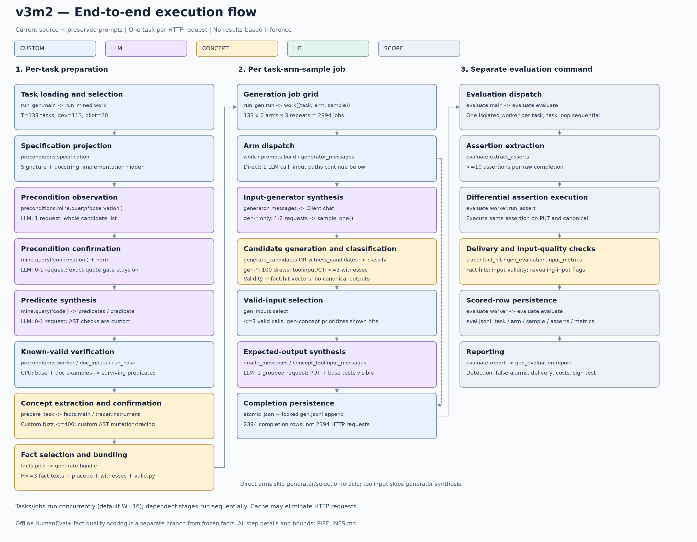
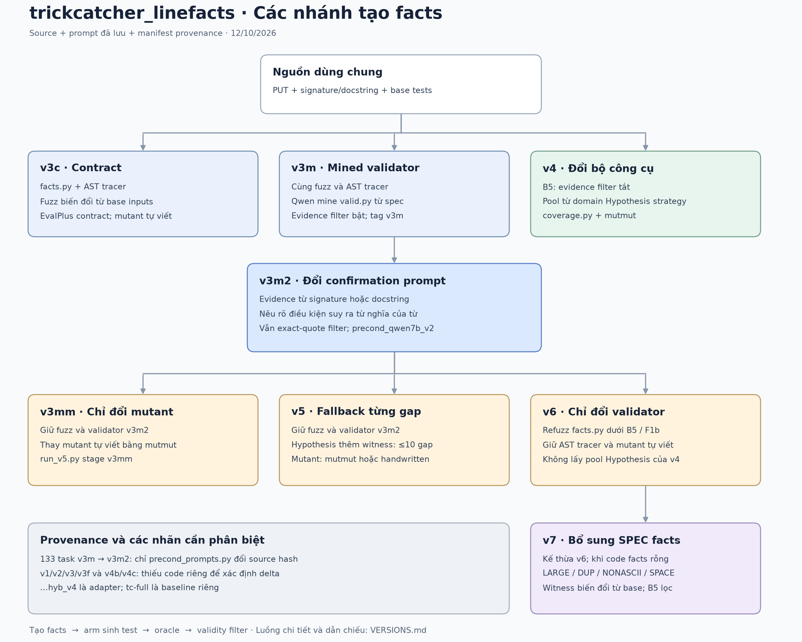
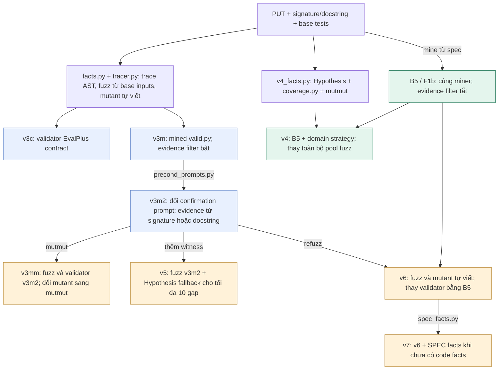
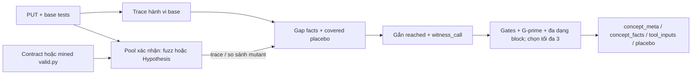
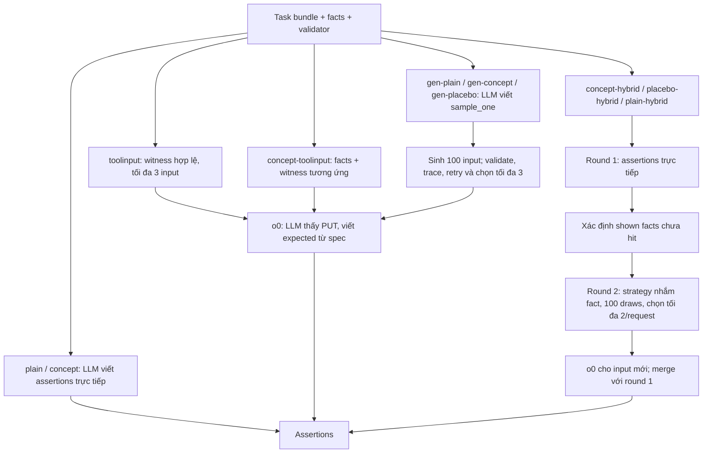
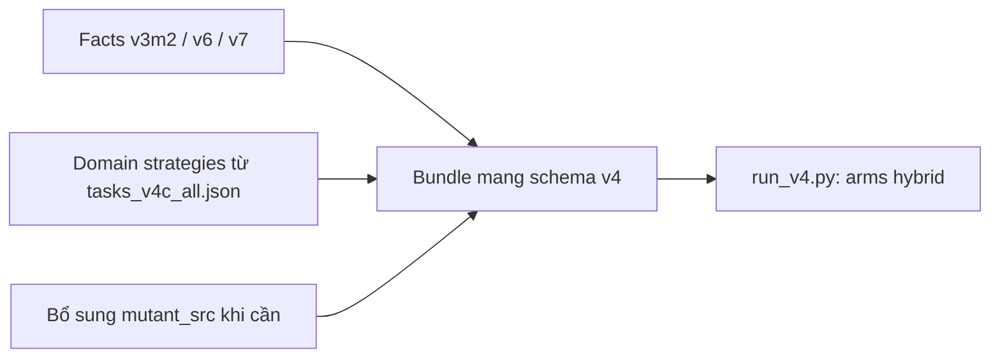
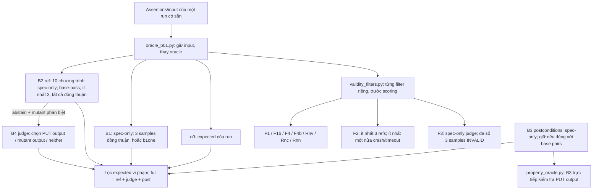
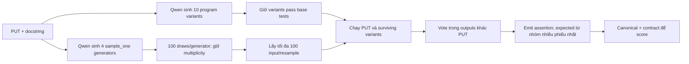

# Sơ đồ các phiên bản `trickcatcher_linefacts`

**Execution flow từ bước đầu đến report cuối, với từng hàm, data shape, LLM calls, libraries, concept locations và scheduling: [PIPELINES.md](PIPELINES.md).**

Phần dưới giữ bản đồ quan hệ phiên bản; nó không thay thế các execution flows trong tài liệu trên.

Đối chiếu **source hiện tại ngày 2026-10-12**, prompt đã lưu và manifest provenance của v3m/v3m2. Không đọc `RESULTS.md`/`results.md`, không chạy thí nghiệm, không dùng số đo để suy ra kiến trúc. Mũi tên biểu diễn phụ thuộc hoặc thay đổi có bằng chứng trong code, không biểu diễn chất lượng phiên bản.

## 1. Các nhánh tạo facts

| Phiên bản / nhánh | Input để xác nhận facts | Validator | Mutation / coverage | Bằng chứng trong source |
|---|---|---|---|---|
| **v3c** | Biến đổi input từ base tests, mục tiêu 400 input hợp lệ, cap 2000 | EvalPlus **prompt + contract** | Mutation tự viết; AST tracer | [`facts.py`](facts.py), [`fuzz_validity.py`](fuzz_validity.py), hằng mặc định của [`run_gen.py`](run_gen.py) |
| **v3m** | Cùng fuzz từ base inputs | Qwen mine `valid.py` từ signature/docstring; evidence phải là đoạn có trong spec | Cùng `facts.py` / `tracer.py` | [`run_gen.py::prepare_task`](run_gen.py), [`preconditions.py::mine`](preconditions.py) |
| **v3m2** | Cùng fuzz v3m; mine lại validators rồi tạo lại facts/bundle | `precond_qwen7b_v2`; **đổi confirmation prompt**, vẫn evidence filter bật và schema `facts_version="v3m"` | Cùng source `facts.py`/`tracer.py` như v3m trong manifest lịch sử | [`precond_prompts.py`](precond_prompts.py), [prompt confirmation cũ](out/precond_qwen7b/7/confirmation_prompt.json), [prompt confirmation v3m2](out/precond_qwen7b_v2/7/confirmation_prompt.json), manifest của hai run |
| **v4** | Qwen viết **domain Hypothesis strategy** từ spec và conditions còn sống; dùng strategy tạo pool facts thay cho fuzz biến đổi | **B5**: tắt kiểm tra evidence substring; vẫn confirmation, code checks và verifier | **mutmut**; **coverage.py** đo statement/branch arcs; AST tracer vẫn đo subconditions và concepts khác | [`run_v4.py::mine/facts`](run_v4.py), [`v4_strategies.py`](v4_strategies.py), [`v4_facts.py`](v4_facts.py), [`v4_tools.py`](v4_tools.py) |
| **v3mm** | Giữ fuzz v3m2 | Giữ validator v3m2 | Chỉ đổi mutation sang **mutmut**; giữ AST tracer | [`run_v5.py`](run_v5.py) stage `v3mm`, [`v5_worker.py::build`](v5_worker.py) |
| **v5** | Giữ fuzz v3m2; thêm witness từ **Hypothesis strategy nhắm từng gap** chưa đạt, tối đa 10 gap/task, cap 200 mỗi attempt, tối đa 1 retry | Giữ validator v3m2 | `--mutant-source` bắt buộc: `mutmut` **hoặc** `handwritten`; giữ AST tracer | [`run_v5.py::mine_tasks/mine_gap`](run_v5.py), [`v5_worker.py::build/targeted`](v5_worker.py) |
| **v6** | Chạy lại fuzz `facts.py` dưới B5; không lấy pool Hypothesis của v4 | **B5 / F1b** | Mutation tự viết; AST tracer | [`run_v6.py::facts/bundle`](run_v6.py) |
| **v7** | Kế thừa v6; biến đổi base inputs theo nhóm **LARGE, DUP, NONASCII, SPACE** để tìm witness | B5 kế thừa v6 | Thêm `kind="SPEC"`, tối đa 3 facts, **chỉ khi `concept_facts` đang rỗng** | [`spec_facts.py::worker/build`](spec_facts.py) |

**Chi tiết dễ nhầm:** v5 chỉ thêm witness cho facts còn trong pool ở hook `evidence`. `facts.py` đã loại mutant không phân biệt được bằng fuzz **trước** hook này, nên fallback không hồi sinh toàn bộ mutant đã bị loại. v7 có thể giữ SPEC fact có witness lớn, nhưng đặt `witness_call=None` nếu biểu diễn input quá 1000 ký tự; vì vậy có fact không đồng nghĩa arm `toolinput` nhận được input đó.

### Delta xác nhận được: v3m → v3m2

Đối chiếu `task_manifests[*].source_sha256` trong [manifest v3m](out/gen2_qwen7b_v3m/manifest.json) và [manifest v3m2](out/gen2_qwen7b_v3m2/manifest.json): **cả 133 task chỉ đổi hash `precond_prompts.py`**; 10 file source còn lại giữ hash. Model, K=3 và 6 arm giữ nguyên. Đây là bằng chứng của hai run lịch sử, không phải khẳng định source hiện tại chưa thay đổi sau đó.

Prompt đã lưu cho thấy observation và code instruction giữ nguyên; **confirmation** đổi ba điểm:

1. Nêu rõ suy luận từ nghĩa của từ, ví dụ length/count/size không âm, index nằm trong sequence.
2. Cho phép trích evidence từ **signature hoặc docstring**, thay vì chỉ yêu cầu docstring.
3. Evidence là từ ngữ làm căn cứ; **không cần tự nó phát biểu đầy đủ điều kiện**.

Code vẫn yêu cầu evidence sau chuẩn hóa là substring có thật trong specification. Vì vậy v3m2 **chưa phải B5**: B5 mới tắt bước evidence filter. Validator thay đổi sẽ làm pool fuzz hợp lệ và facts được chọn thay đổi, dù thuật toán fuzz/ranking giữ nguyên.

Ví dụ code lưu của task 7: v3m có [`valid.py`](out/precond_qwen7b/7/valid.py) trả `True`; v3m2 có [validator mới](out/precond_qwen7b_v2/7/valid.py) kiểm tra `strings` là list các string và `substring` là string. Ví dụ này minh họa delta validator, không chứng minh chất lượng v3m2 tốt hơn.

**Tên lịch sử chưa đủ code để vẽ delta:** `facts`, `facts_v2`, `facts_v3`, `facts_v3f` còn được tham chiếu như output cũ trong `run_gen.py`/`eval_v3m.py`; `generate.py` bundle pilot từ `facts_v3f`. Không có các implementation riêng hoặc snapshot cũ trong folder hiện tại để xác định chắc chắn v1 → v2 → v3 → v3f. `v4b`/`v4c` là tên run/bundle có trong workspace; code hiện tại dùng chung runner v4 và chỉ tham chiếu `tasks_v4c_all.json`, nên sơ đồ không gán cho chúng thay đổi thuật toán chưa chứng minh được.

## 2. Pipeline facts và phần dùng chung

Các nhánh code facts v3c/v3m/v4/v3mm/v5/v6 dùng lại templates và ranking của `facts.py`: slots được xếp hạng là **OUTCOME, STMT, MUTANT, BOUND, NUM, DU**; `MUTANT-X` được gộp vào MUTANT. Các loại LOOP, LOOP-MAX, OUTPUT, REL, DECISION, SHAPE có thể được thu thập nhưng không phải tất cả được chọn mặc định. `pick()` chỉ chọn facts `reached`, giảm ưu tiên qua G-prime và tránh lặp block/DU key. v7 chọn SPEC theo thứ tự riêng `LARGE → DUP → NONASCII → SPACE`, không chạy lại `pick()`.

Fact mô tả hành vi **base tests chưa phủ**, không tự khẳng định PUT sai và không cung cấp expected output. Placebo mô tả hành vi base tests đã phủ; với code facts, cố khớp kind mix của top facts. Nguồn: [`facts.py::main/pick/guard_features`](facts.py), [`v4_facts.py::build`](v4_facts.py), [`spec_facts.py::build`](spec_facts.py).

## 3. Từ facts sang test: các arm và adapter hybrid

| Runner | Các arm có trong code | Cách sử dụng |
|---|---|---|
| [`generate.py`](generate.py) / [`prompts.py`](prompts.py) | `plain`, `concept`, `placebo`, `coverage`, `toolinput` | Pilot 5 arm; đều thấy PUT và base tests. |
| [`run_gen.py`](run_gen.py) / [`gen_prompts.py`](gen_prompts.py) | Mặc định `plain`, `concept`, `toolinput`, `gen-plain`, `gen-concept`, `gen-placebo`; thêm tùy chọn `concept-toolinput` | Generator dùng template input của TrickCatcher, sau đó **LLM viết expected**. Với `--from-bundle`, dùng facts/validator trong bundle. |
| [`run_v4.py`](run_v4.py) / [`v4_prompts.py`](v4_prompts.py) | `plain`, `concept`, `toolinput`, `gen-plain`, `concept-hybrid`, `placebo-hybrid`, `plain-hybrid` | Domain strategy + targeted strategies. `concept-hybrid` tái dùng round 1 của `concept`; `plain-hybrid` tái dùng `plain` và khớp **số strategy requests thực tế** của `concept-hybrid`. |

`placebo-hybrid` nhắm covered placebo facts. `plain-hybrid` không có fact cụ thể; xin input chưa được base tests exercise, không retry strategy. Concept/placebo hybrid được tối đa 1 retry/request; oracle round 2 chỉ gọi khi có strategy request. Số requests khác số facts vì có retry.

**Adapter không phải phiên bản facts:**

`run_v6.py::bundle` tạo `tasks_v6_all.json` cho `run_gen.py` và `tasks_v6hyb_v4.json` cho `run_v4.py`: giữ facts v6, chép **strategy metadata** từ v4c, bổ sung source mutant tự viết và đổi `facts_version` sang `v4`. `spec_facts.py::build` tạo v7 cho cả hai dạng bundle. Code v6 nhắc cùng recipe của `tasks_v3m2hyb_v4.json`, nhưng không có entry point tạo adapter v3m2 riêng trong source hiện tại.

`facts_version` là **schema/dispatch tag**, không luôn là tên thí nghiệm: v3m2/v3mm/v5/v6 giữ tag `v3m`; các bundle hybrid giữ tag `v4`. `v5_worker.py::targeted` dùng lại `v4_worker.py::draw`, nhưng validator thực tế lấy từ `task['mined_valid_src']`; nhãn thống kê `B5` trong worker không có nghĩa v5 đã đổi sang B5.

## 4. Oracle và validity filter là trục thử nghiệm riêng

- **F1** = validator v3m2, evidence filter bật; **F1b = B5** = evidence filter tắt.
- **F4/F4b** đổi observation prompt để mine theo categories; F4b thêm ba quy tắc. Vẫn gọi `preconditions.mine(..., evidence_filter=False)`. Đây là **validator variants**, không phải pipeline facts v4. Nguồn: [`precond_concepts.py`](precond_concepts.py).
- **Rnv/Rnc/Rnn** tương ứng bỏ verifier, bỏ confirmation, bỏ cả hai trong B5. Nguồn: [`rbc_ablation.py`](rbc_ablation.py).
- B0 `dpp`/`tc` trong [`oracle_b01.py`](oracle_b01.py) đọc variants GPT-3.5 đã phát hành để áp oracle lên input của run hiện tại. Chúng khác baseline `tc-full`, vốn tự sinh cả input pool và variants.

Canonical solution dùng để score. Với v3c, EvalPlus **contract** còn được dùng làm method-side validator; với nhánh mined, valid.py thay contract ở method side. Không nên gộp contract và canonical solution thành một node “ground truth” cấp vào mọi nhánh.

## 5. `tc-full`: baseline riêng, không phải đời tiếp theo của linefacts

Nguồn: [`tc_full.py::generate/execute_task`](tc_full.py), [`tc_full_worker.py::base_filter/execute`](tc_full_worker.py). Prompt templates được kiểm SHA256; model là Qwen2.5-Coder-7B-Instruct. `tc-full` lấy task source từ bundle v4/v3m nhưng **không đưa concept facts hay mined validator vào prompt generation**. Pool input không bị contract lọc trước khi vote; contract được dùng khi chấm assertion. Worker bỏ input khi PUT không có output thành công; assertion chọn nhóm đầu tiên trong các nhóm đồng hạng lớn nhất. Phần `subset_scores()` tính metric riêng và giữ tất cả maximal-vote ties. Main mặc định 3 resamples; RQ2 thay PUT bằng canonical, dùng 1 resample để đo false alarms.

## Đọc sơ đồ

Có bốn lựa chọn độc lập cần phân biệt: **cách tạo facts → arm sinh input/test → oracle → validity filter**. Tên phiên bản facts, tên run, và schema tag không thay thế được nhau. Sơ đồ phản ánh implementation đọc được; không kết luận phiên bản nào tốt hơn hoặc run nào hoàn tất.
