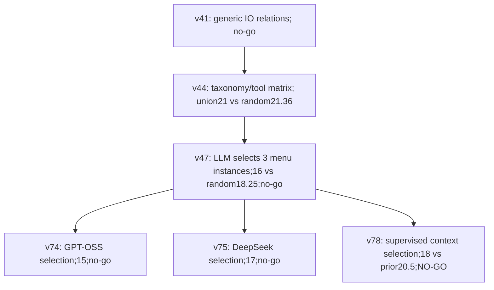

# Concept-selection branch

v78 keeps the v47 menu and cached input outcomes, learns candidate usefulness only from other specification groups, and tests whether spec/code context improves ranking. It replaces no generator or oracle. 33 PUTs /24 independent problems, fixed logistic model, exact tie averages, input-cost-conditioned random controls; $0 API and no new program execution.

- **Result:** primary context18, context-removed19, subtype prior20.5, random18.25; secondary context21=context-removed21=subtype21. All registered promotion gates fail for primary.
- **Concept kinds:** input class, spec boundary, spec-range spread, public-value bias, uncovered path, surviving mutant. No new taxonomy was introduced.
- **Metric:** reach@3 = expected PUT count with at least one confirmed exposing input in selected bundles, not assertion correctness. Cost = distinct input union per PUT; fractional metrics average exact boundary ties.
- **Provenance:** original diagnostic implemented with scikit-learn; CASCADE is motivation only, not reproduced. See [PREREG](PREREG.md) and [results](RESULTS.md).
- The local diagram `out/diagram/conceptester-v4.html` is updated. No connected tool for publishing the legacy Claude artifact is available in this session.
