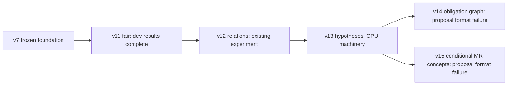

# New concept variants, 2026-10-14

| Variant | New concept use | Main exploratory contrast | Status |
|---|---|---|---|
| [v14_obgraph](v14_obgraph/README.md) | Spec obligation + tool concept anchor + connected dependency path + T/O | graph vs same-evidence cards | GPU complete; 0 accepted cards/20 tasks |
| [v15_mrconcept](v15_mrconcept/README.md) | Conditional family + D/tau/rho + valid source/follow-up pairs | guided vs blind, identical pair filter | GPU complete; 0 accepted cards/20 tasks |

Both add original/new-pool toolinput and witness-only controls and keep main detection on common saved ref responses.
Each proposes up to six cards, shows up to three and has three strategy slots/sample. Initial scope is 20 dev tasks,
K=1; no held-out run. v14 consumes at most 440 logical model requests, v15 at most 380 (820 combined), including
shared proposal calls, excluding transport retries and cache hits from actual new usage. Ref responses are already
cached; no new expected-value/reference requests are required. Actual tokens must be reported after the online run.

References informing design are in [the research report](../research/relations_2026-10-14/REPORT.md).
Both variants are original LineFacts adaptations, not implementations of PromeFuzz/MR-Coupler/MemoRIA.
The user subsequently corrected the order: resume B3 then B4 before returning to v14/v15. The two smoke runs
had already finished when this correction arrived; their zero-card failure is recorded without changing treatment.
The private Claude diagram has not been edited; this local tree records the new variants for the next handoff.

## Ordered format-repair copies

Initially gated on B3 and B4 scoring. User later authorized using the GPU during B4 CPU-heavy work;
the new overlap chain runs
[v14_obgraph_py](v14_obgraph_py/README.md) then [v15_mrconcept_py](v15_mrconcept_py/README.md).
Only Python/JSON proposal guidance changes; zero accepted cards now stops generation. 30 CPU tests pass,
20-task preparation is complete; v14 model stages launched alongside B4 with two workers, then v15.
The dormant old waiter was stopped; original method budgets/seeds/validators remain frozen.
See [GPU queue](../GPU_QUEUE-2026-10-14.md) for progress paths, dependency gates and resume rules.

GPU restart checkpoint: repaired v14 accepted 5 shown cards on 3/20 tasks and enabled generation.
The original v14 zero-card result remains separate; repaired effectiveness scoring is pending.

Completed repaired runs: v14 has 5 shown cards on 3/20 tasks, primary graph/card D_IO 6/6;
v15 has 41 shown cards on 16/20 tasks, MR/blind D_IO 5/5. See RESULTS §11.46 and the tracked
[format-repair report](../analysis/v14_v15_format_repair.md). B4 generation completed and CPU evaluation is running.
