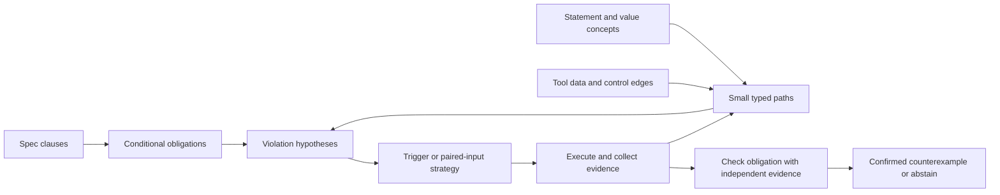

# Relation, graph và knowledge concepts cho LineFacts

Ngày: 2026-10-14. Đọc `HANDOFF-2026-10-14.md`, memory, RESULTS §11.35–11.42, source v12/v13 và full text của các paper trong bảng dưới. Phạm vi là research và thiết kế; chưa chạy method mới. Mỗi paper có folder riêng. Source/version/hash và mức kiểm artifact nằm trong `SOURCES.json`.

**Đề xuất chính: phát triển LineFacts thành graph của spec obligations, statement concepts và execution evidence; dùng graph để chọn một test obligation cụ thể rồi sinh input.** Hướng mở rộng đáng thử tiếp là conditional metamorphic relations. Contribution cần nằm ở cách nối concept với nghĩa của spec và dùng nó để tìm counterexample.

## 1. Trạng thái thực tế làm cơ sở

Theo [handoff](../../../HANDOFF-2026-10-14.md) và [RESULTS](../../RESULTS.md), dev 113 task, K=3, ref:

| Arm | Bug/run | Ý nghĩa |
|---|---:|---|
| toolinput | 64.3 | Mốc phải vượt hoặc bổ sung bug khác |
| concept-hybrid v11 | 61.0 | Chưa hơn rõ plain hoặc matched placebo |
| matched placebo-hybrid | 57.7 | Confound số request round 2 trước đây rất lớn |
| plain-hybrid | 55.7 | Control cùng tool và ngân sách |
| witness-only | 43.0 | Phần input discovery đã có từ fuzz |

`Bug/run` = detecting samples / K, không phải số bug duy nhất. Con số paper khác không so trực tiếp với bảng này.

**B3 đã triển khai** trong [v12_rel](../../pipelines/v12_rel/RELATIONS.md): observed def-use, AST enclosing guards và lexical spec links. Có 206/254 hint với ít nhất một edge trên 133 task dev+pilot; spec links có ở 142 hint. Đây là coverage của biểu diễn, chưa là kết quả bug detection. Lúc đọc phiên này, `out/runlogs_v12/steps.txt` chỉ có `bundle 0`; chưa thấy final B3 report. Không suy diễn run đã thành công hay thất bại từ handoff cũ.

**B4 đã triển khai CPU machinery** trong v13_hyp: proposal `(R, chain, T, expected_violation)`, giữ unwitnessed hypotheses, xét covered sites, T-filtered search và mutant-difference ranking. Các giới hạn đã kiểm từ source:

- [hypotheses.py](../../pipelines/v13_hyp/hypotheses.py) kiểm R là quotation, line IDs thuộc candidate sites, T parse/pure. Chưa kiểm từng hop của chain là data/control edge có trong graph.
- [hyp_worker.py](../../pipelines/v13_hyp/hyp_worker.py) kiểm T trên base inputs/witnesses và PUT–mutant output difference. T satisfied và mutant difference là evidence cho input/alternative behavior; chưa xác nhận spec violation hay local infection.
- B4 amendment 1 trong [PREREG](../../PREREG.md) đã tránh hypothesis truncation bằng budget=max(rel,hyp). Cảnh báo truncation trong HYPOTHESES.md phản ánh mốc trước amendment.
- [rel_prompts.py](../../pipelines/v12_rel/rel_prompts.py) cân `non-whitespace runs`, thêm `.` padding; đây chưa phải tokenizer equality. B3 thêm cả evidence lẫn relations, nên rel>flat vẫn chưa cô lập topology.

Đây là các điểm thiết kế cho version tương lai, không phải đề nghị sửa các run đang đăng ký.

## 2. Paper nào đáng dùng, và dùng cho việc gì?

| Paper / nguồn gốc | Phần có ích cho LineFacts — đánh giá của phiên này | Fit / giới hạn |
|---|---|---|
| [PromeFuzz, CCS 2025](https://pvz122.github.io/pdf/25-promefuzz.pdf) · [note](papers/promefuzz/NOTES.md) | Constraint knowledge tách khỏi code metadata; chọn context theo target | Cao cho thiết kế knowledge; harness/API setting khác |
| [MR-Coupler, FSE 2026](https://arxiv.org/html/2604.10126v2) · [note](papers/mr_coupler/NOTES.md) | Functional coupling gợi ý semantic relations và test obligations | Cao cho nhánh MR; method-pair Java khác pure function |
| [MemoRIA, FSE 2024](https://mpapad.github.io/publications/pdfs/metamorphic_relation_inference.pdf) · [note](papers/memoria/NOTES.md) | Abstract concepts làm điều kiện của relation; prune redundant obligations | Cao về concept abstraction; stateful object setting |
| [MetaFOE, preprint 2026](https://arxiv.org/html/2606.14164v1) · [note](papers/metafoe/NOTES.md) | Tách relation validity khỏi implementation validity | Cao cho kiểm oracle/MR; cần manual validation |
| [HITS, ASE 2024](https://arxiv.org/abs/2408.11324) · [note](papers/hits/NOTES.md) | Context nhỏ theo slice để giảm việc Qwen phải suy luận | Vừa; coverage evidence, complex Java methods |
| [TELPA, TOSEM 2025](https://arxiv.org/abs/2404.04966v2) · [note](papers/telpa/NOTES.md) | Dependencies và real usage giúp chuyển target thành input | Vừa; ít interprocedural context trong HumanEval |
| [DBcover, arXiv 2026](https://arxiv.org/html/2608.25573v1) · [note](papers/dbcover/NOTES.md) | Nối input–trace–code, chọn seed gần target | Vừa/thấp cho task nhỏ; chủ yếu coverage |
| [Think-on-Graph, ICLR 2024](https://arxiv.org/abs/2307.07697v6) · [note](papers/think_on_graph/NOTES.md) | Chọn path ngắn từ graph thay đưa cả graph vào prompt | Tham khảo reasoning; QA evidence không chứng minh testing |
| [PDG, TOPLAS 1987](https://www.cs.utexas.edu/~pingali/CS395T/2009fa/papers/ferrante87.pdf) · [note](papers/pdg/NOTES.md) | Định nghĩa data/control dependence và giới hạn của slicing | Foundation; thêm PDG tự nó chưa là contribution mới |

Hai paper đã research trước: [CKGFuzzer](https://arxiv.org/abs/2411.11532) chủ yếu cho structural retrieval; xem [memory đã kiểm](../../../memory/ckgfuzzer-paper-facts.md). [ConceptCoder](https://arxiv.org/abs/2603.23470) cho vocabulary/tool labels/training, xem [memory](../../../memory/conceptcoder-paper-facts.md). Không lấy kết quả concept-supervised training làm bằng chứng rằng graph prompting sẽ thắng.

## 3. Phân biệt ba loại relation

**Program relations** trả lời “giá trị đi qua đâu, điều kiện nào ảnh hưởng statement?”. Ví dụ def-use, control dependence, object read/write. Chúng giúp định vị và dựng slice.

**Semantic relations** trả lời “spec đòi hành vi gì khi các input/values có quan hệ này?”. Ví dụ strict threshold, tie-breaking, preservation of multiplicity, permutation invariance có điều kiện. Chúng biến một slice thành test obligation.

**Evidence relations** trả lời “đã quan sát hoặc kiểm điều gì?”. Ví dụ input reaches site, trace supports dependency, base input satisfies trigger, ref agrees với expected result. Chúng quyết định mức tin cậy và bước search tiếp theo.

Graph hữu ích cho LineFacts khi cả ba lớp cùng tham gia selection và validation. Một relation do LLM dự đoán vẫn là candidate; một edge quan sát trên vài trace không trở thành universal property.

## 4. Schema đề xuất: concept phải quyết định test

Đây là schema nghiên cứu của phiên này, không phải schema được lấy nguyên từ một paper.

| Node | Nội dung |
|---|---|
| SpecClause | Exact quotation + source span |
| Obligation | Domain D, expected property O, behavioral category |
| Concept | Statement concept hoặc input/value class; vocabulary cố định |
| CodeSite | Statement/guard/return, source ID |
| Input / Execution | Args identity, trace, validity status |
| Hypothesis | Obligation + typed path + trigger T + predicted violation |

| Edge | Evidence để chấp nhận |
|---|---|
| `SPECIFIES`: clause → obligation | Quotation và diễn giải; candidate cho tới khi kiểm semantic |
| `ANNOTATES`: concept → site/value | AST hoặc trace/tool label |
| `DATA_DEPENDS`, `CONTROL_DEPENDS` | Tool evidence; phân biệt static may-edge với observed edge |
| `MAY_VIOLATE`: site/path → obligation | Hypothesis; không gắn status fact |
| `REACHES`, `SATISFIES_TRIGGER` | Execution trên valid input |
| `PROPAGATES_TO_OUTPUT` | Trace/intervention evidence phù hợp; không suy ra chỉ từ reaches |
| `SUPPORTS`, `REFUTES` | Evidence record + checker + finite domain đã kiểm |

Mỗi node/edge giữ provenance: `source_kind`, source span/trace ID, checker, domain assumptions, status (`candidate`, `observed`, `refuted`, `unknown`). Độ tin cậy của LLM không thay cho status. Domain validator cũng chỉ là operational approximation.

Concept cần có tác dụng: class/value labels quyết định obligation nào được xét, relation nào hợp lệ, trigger nào cần sinh hoặc graph path nào được chọn. Nếu bỏ concept labels mà pipeline vẫn chọn cùng inputs theo cùng cách, contribution đang nằm ở graph/tool chứ chưa ở concept.

## 5. Ba hướng, theo thứ tự nên làm

### A. Grounded obligation graph — ưu tiên cao nhất

Phát triển tiếp B3/B4: proposal chỉ được chọn IDs của existing nodes và typed edges; có thể thêm candidate spec link nhưng phải đánh dấu. Tool xác nhận chain membership/adjacency và domain. Trích một slice ngắn nối input/value → guard → observable output, gắn một obligation và một trigger.

Chỗ cần tăng chất lượng là **discriminating trigger**: input phải phân biệt hành vi hợp spec với một cách hiểu sai cụ thể. “List có duplicates” vẫn thô; “duplicate minimum nằm sau minimum đầu tiên, trong task yêu cầu giữ tất cả occurrence” mới nối domain class với predicted violation. Ví dụ này chỉ là mẫu thiết kế, chưa xác nhận task hiện có nào mang bug đó.

Cho phép covered sites. Base test đã chạy line hoặc có một input thỏa T chưa bảo đảm đã kiểm hết obligation. Nên phân biệt `site covered`, `trigger class sampled`, `obligation exercised`, `counterexample found`. Rule B4 “một base input thỏa T → drop” chỉ hợp khi T đủ cụ thể cho một scenario; với T thô nó có thể bỏ mất semantic interaction. Giữ protocol hiện tại và ghi đây là hypothesis cho version sau.

Giữ Hypothesis strategy cho input generation vì v9 literal-call feedback đã kém (§11.36). Dùng graph cho target/filter và lời giải thích tool có thể kiểm, không cần model viết reasoning dài.

### B. Conditional metamorphic concepts — nhánh semantic đáng thử nhất

Một relation card chứa `(spec evidence, precondition D, input transform tau, output relation rho, linked concepts/sites)`. Tool sinh source input x và follow-up tau(x), kiểm validity của cả hai rồi kiểm rho trên outputs.

Relation families ban đầu chỉ nên gồm những loại spec cho phép: permutation invariance/equivariance, monotonicity, idempotence, multiplicity preservation, inverse/round-trip. Ordering-sensitive task cần output permutation/equivariance hoặc không dùng family này. Không tự mặc định normalize Unicode, scale floats hay duplicate inputs đều bảo toàn kết quả.

**Ví dụ từ spec HumanEval/0, thiết kế trên giấy:** tìm hai numbers có distance nhỏ hơn threshold. Permuting numbers phải giữ output. Threshold tăng phải giữ True nếu trước đó True. Với numbers `[0,2]`, strict boundary yêu cầu False ở threshold=2 và True ở threshold=3. Hai MR đầu còn cho constant-False implementation lọt qua; strict boundary obligation bổ sung kiểm expected behavior. Chọn integers và threshold biểu diễn chính xác để ví dụ không phụ thuộc float rounding. Đây không phải kết quả execution.

Tách hai phép thử: (1) MR tạo input pairs rồi tất cả arm vẫn dùng ref oracle chung, để đo input discovery; (2) MR làm oracle, để đo phần oracle riêng. Nếu đổi cả input lẫn oracle trong một arm, không biết gain đến từ đâu.

**Điểm phải thích nghi từ literature:** LineFacts PUT đã biết là buggy. Không loại relation chỉ vì nó fail trên PUT; có thể đó chính là counterexample. Không suy intended semantics chỉ từ relations mined trên buggy execution. Relation phải có spec evidence và independent checking; ref programs cho evidence hữu hạn, không cho proof. Mutation killing đo sensitivity, không tự xác nhận correctness của relation.

### C. Abstract state/protocol concepts — để sau

Hữu ích khi có stateful objects, resource lifecycle hoặc class methods tương tác qua shared state. Concepts kiểu empty/nonempty, initialized/uninitialized, sorted/unsorted quyết định transitions và relation preconditions.

HumanEval phần lớn là hàm nhỏ, nên chưa ưu tiên full protocol KG hoặc graph database. VibePass có `Solution` class không đồng nghĩa benchmark có object lifecycle; cần kiểm shared state qua nhiều calls trước khi chọn nhánh này. MemoRIA là reference tốt về abstraction, nhưng mô hình current behavior của buggy PUT cần được kiểm lại với spec.

## 6. Experiments để chứng minh relation/concept có ích

Phần này là **proposal**, chưa PREREG và chưa triển khai. Chờ B3/B4 trước khi chọn thêm variant. Version mới vẫn copy best pipeline vào folder mới có CHANGELOG.

| Contrast | Giữ gì bằng nhau | Claim kiểm được |
|---|---|---|
| Same evidence as list vs true typed graph | Node text, spec clauses, edge evidence, calls, budget | Tác dụng topology/relational representation |
| True graph vs dropped edges | Nodes/evidence, retrieval allowance | Tác dụng dùng relations để chọn target |
| True graph vs rewired typed edges | Node/type counts và độ dài | Model/tool có nhạy với relation correctness không |
| Graph + clause links vs graph without links | PUT/spec vẫn thấy ở prompt chung | Tác dụng explicit spec–code links |
| Graph with concepts vs same graph without concept labels | Raw evidence, tool capabilities | Tác dụng riêng của concept abstraction |
| Hypothesis graph vs same hypotheses as cards | R/T/expected violation và proposal cost | Gain có đến từ graph hay từ hypothesis content |
| Graph/MR vs toolinput và witness-only | Common scorer, input/execute budget | Giá trị vượt input đã được fuzz tìm |

Rewired edges có thể gây hại chủ động: cần cả edge-deletion control, không lấy thắng rewired placebo làm bằng chứng duy nhất. Nếu graph arm được thêm relations/evidence trong khi flat arm không có, contrast đo bundle augmentation.

Hai tracks cần tách: **representation track** giữ chung selected targets/witness pool; **selection track** cho graph chọn target rồi báo selection+generation như một bundle. Graph selection thay witness pool thì phải có witness-only/toolinput tương ứng với pool mới, cùng với frozen baselines cũ.

Ngân sách: đo actual Qwen tokenizer tokens, proposal calls, generation calls, draws, PUT executions, mutant executions, ref/oracle cost và wall time. Một MR assertion có thể gọi PUT hai hoặc nhiều lần; assertion cap không thay execution cap. Punctuation padding không chắc trung tính: báo token cap và consumed cost, không gọi whitespace equality là token equality.

Metrics chính vẫn là D_IO/precision trên bug benchmark. Bổ sung obligation hit rate, validated chain rate, relation rejection reasons, output-reaching paths, input overlap với existing witnesses, incremental detected tasks ngoài witness baseline, valid unwitnessed-hypothesis counterexamples và covered-site detections. D_I tăng mà D_IO không tăng gợi ý phần oracle/obligation còn yếu; chain rate tăng mà input hit không tăng gợi ý translation còn yếu.

Chọn một primary contrast trước run; task là đơn vị thống kê, ba samples không độc lập như ba tasks. Secondary contrasts dùng multiplicity correction đã đăng ký; paired intervals cùng effect size. Dev cho thiết kế, pilot lịch sử báo riêng. MBPP real12 đã được đọc; không dùng như fresh confirmation cho hướng lấy cảm hứng từ kết quả đó. Giữ held-out gate hiện tại và dùng tập xác nhận còn chưa đọc nếu cần claim mới.

## 7. Decision đề xuất

1. Hoàn tất kết luận B3, rồi B4 đã đăng ký. Nếu gain không rõ, kiểm chain/obligation/trigger metrics trước khi thêm graph complexity.
2. Nếu B4 có tín hiệu, phát triển **A**: grounded paths + semantic obligations + provenance; contribution ở operational use của concepts.
3. Nếu gain vẫn chỉ từ witness/search, thử **B** với conditional MR cards và same-oracle track. Đây là phép thử semantic khác đủ rõ để không chỉ đổi cách trình bày flat facts.
4. **C** chỉ khi dataset thật sự cần state/protocol reasoning.

Claim nghiên cứu phù hợp để hướng tới: “Tool-grounded relational concepts select specification-discriminating tests for residual bugs after base tests.” Claim này chỉ được viết như kết quả sau fair ablations và fresh confirmation. Phiên research hiện tại chưa chứng minh graph hay MR sẽ thắng.
